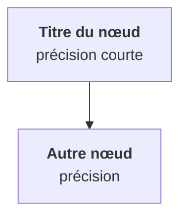

# Générer les leçons d'une étape

Argument : un numéro d'étape (`5`, `etape-05`) ou une plage (`5-7`). Sans argument, prends la première étape de `src/data/etapes.ts` qui n'a pas encore de dossier dans `src/content/lecons/`.

Traite les étapes **une par une**, dans l'ordre, et fais tout le travail sans poser de question : Hugo lance souvent ce skill depuis son téléphone et relit le résultat dans l'aperçu.

## 1. Lire avant d'écrire

1. Trouve l'étape dans `src/data/etapes.ts` (numéro, titre, `dossier`).
2. Lis le fichier source `sources/etape-NN-*.md` **en entier**.
3. Lis `sources/00-plan-roadmap.md` (la ligne de l'étape et ses voisines) pour savoir ce qui a déjà été vu et ce qui viendra.
4. Lis deux leçons existantes comme référence de ton et de format : `src/content/lecons/01-architecture/04-trajet-apply.mdx` et `src/content/lecons/01-architecture/07-service-labels.mdx`, et le lab `src/content/lecons/01-architecture/90-lab-reconciliation.mdx`.

**Source absente** (étapes 23 et 24 notamment) : écris d'abord `sources/etape-NN-<slug>.md` dans le même format que les autres sources (Objectif, sections numérotées NN.1, NN.2…, Exercice clavier en main, Validé si…, Étape suivante), à partir de la ligne du plan et de recherches web sur la doc officielle (Kubernetes, Helm, ArgoCD, Flux, Velero, CNCF pour CKAD/CKA). Pour l'étape 23, appuie-toi aussi sur ce que disent déjà les sources des étapes 11 à 22 pour les réponses aux questions client : ne réponds jamais à leur place par une affirmation non sourcée, écris « à vérifier pour ton produit » quand c'est spécifique. Signale-le en tête de la PR.

## 2. Découper

Fais un plan avant d'écrire : une liste de leçons, chacune avec un titre et **l'unique idée** qu'elle transmet.

- Visée : 4 à 10 leçons par étape. Une sous-section de la source ≈ une leçon ; une sous-section dense se coupe en deux ; deux petites se fusionnent.
- Ordre = ordre de la source, sauf si une notion est utilisée avant d'être expliquée.
- La section « Exercice » de la source devient **un seul lab** (`90-lab-<slug>.mdx`).
- La section « Validé si… » de la source alimente les quiz (chaque point doit être testé par au moins une question quelque part dans l'étape).
- Les tableaux de commandes de la source se répartissent dans le champ `commandes` des leçons concernées.

## 3. Écrire chaque leçon

Fichier : `src/content/lecons/<dossier>/<NN>-<slug>.mdx`, `NN` = `ordre` sur deux chiffres, slug en minuscules sans accents.

````mdx
---
titre: "Titre court, une affirmation ou une question (≤ 60 caractères)"
etape: 5
ordre: 3
objectif: "Ce que tu sais faire ou expliquer après la leçon, en une phrase."
commandes:
  - c: "kubectl get pvc -A"
    d: "à quoi elle sert, en quelques mots"
quiz:
  - q: "Une situation concrète, puis la question ?"
    choix:
      - "Réponse plausible"
      - "La bonne réponse"
      - "Réponse plausible"
    bonne: 1
    explication: "Pourquoi c'est la bonne, et ce qui cloche dans l'erreur tentante."
---

Une ou deux phrases d'accroche : pourquoi ça compte sur le terrain.



## Sous-titre

Prose courte, paragraphes de 2 à 4 phrases, listes et tableaux quand ça aide.

<Piege>
Optionnel : une erreur fréquente, son symptôme, le réflexe.
</Piege>

<Retenir>
Une à trois phrases. Ce qu'il faut garder si on oublie tout le reste.
</Retenir>
````

### Le texte

- **180 à 550 mots** de prose (hors code et schémas). Le quiz et les commandes complètent les 5 minutes.
- Tutoiement, phrases courtes, vocabulaire du terrain. Ancre dans le contexte d'Hugo : plateforme LLM, charts parapluie, clusters clients hétérogènes.
- Pas de titre `#` (le titre vient du frontmatter) ; sous-titres en `##`.
- Termes techniques en `code` quand ce sont des noms d'objets, de champs ou de commandes.
- **Fidélité** : tu reformules, découpes et illustres la source. Tu n'ajoutes pas de fait technique qui n'y est pas, sauf petit complément vérifié dans la doc officielle.
- MDX : jamais d'accolades ni de `<mot>` hors backticks dans le corps.

### Les schémas (l'essentiel de la valeur sur téléphone)

- **Au moins un par leçon**, deux si la leçon a deux idées visuelles. Choisis ce que la prose expliquerait mal : un trajet, une hiérarchie, un arbre de décision, un avant/après.
- Toujours `flowchart TD` (vertical). Jamais `LR` : l'écran fait 390 px de large.
- 3 à 8 nœuds, 2 nœuds côte à côte au maximum.
- Libellés : `"<b>Nom</b><br/>précision courte"`, moins de 30 caractères par ligne. Libellés toujours entre guillemets.
- `subgraph` pour la contenance (un nœud contient des pods), flèches pointillées `-.->` pour ce qui est ignoré ou secondaire, libellés d'arêtes `-->|"texte"|` courts.
- Pas de `classDef` ni de `style` : le thème du site gère les couleurs en clair et en sombre.
- Évite les losanges de décision `{ }` (très larges) : préfère l'hexagone `{{"…"}}` ou des libellés d'arêtes.

### Le code

- Un bloc YAML de 16 lignes maximum quand il éclaire la notion, 2 blocs par leçon au maximum.
- **Pas de séquences bash** dans une leçon : les commandes vont dans `commandes` (0 à 5, celles qu'il faut savoir reconnaître et retrouver), les manipulations dans le lab.

### Le quiz (3 ou 4 questions)

- Tester la compréhension et le réflexe, pas la mémoire d'un détail. Format idéal : « Situation chez un client, symptôme observé. Que fais-tu / quelle est la cause ? »
- 3 choix (4 au maximum), tous plausibles, de longueur comparable. Pas de « toutes / aucune des réponses » (les choix sont mélangés à l'affichage).
- Varie l'index de `bonne`.
- `explication` : pourquoi la bonne est bonne, et le piège de la mauvaise la plus tentante.
- Chaînes entre guillemets doubles ; un guillemet dans le texte s'échappe en `\"`.

## 4. Écrire le lab

`90-lab-<slug>.mdx`, `type: lab`, `ordre: 90`, `duree` ≈ temps réel / 4, pas de quiz. Reprends l'exercice de la source en étapes numérotées `## 1. …`, commandes en blocs `bash`, ce qu'on doit observer après chaque bloc, et termine par le nettoyage. Rappelle en une phrase le prérequis (cluster kind `lab`, étape précédente faite).

## 5. Vérifier

```bash
npm ci        # si node_modules absent
npm run check # contrôle qualité + build
```

Corrige **toutes** les erreurs ; traite les avertissements sauf raison valable (à mentionner dans la PR). Relis ensuite chaque leçon en te posant trois questions : une seule idée ? le schéma apprend-il quelque chose que la prose ne dit pas ? le quiz piégerait-il quelqu'un qui a survolé ?

## 6. Livrer

1. Branche `lecons/etape-NN` (ou `lecons/etape-NN-MM` pour une plage), un commit par étape : `Leçons étape NN : <titre de l'étape>`.
2. Push, puis ouvre une PR vers `main` si l'outil le permet. Description : la liste des leçons (titre, une ligne), le nombre de questions, le lab, et tout écart à signaler (source créée, avertissement conservé, ajout hors source).
3. Cloudflare Pages publie un aperçu de la branche : Hugo relit sur son téléphone et merge.

Ne modifie rien d'autre que `src/content/lecons/<dossier>/` (et `sources/` si la source manquait).
