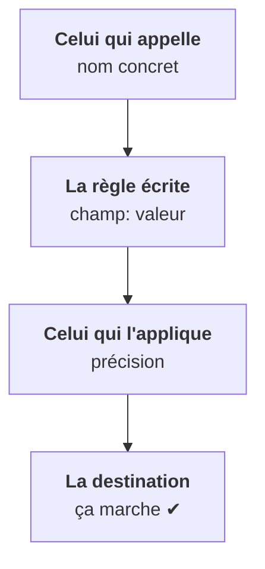

# Générer les leçons d'une étape

Argument : un numéro d'étape (`5`, `etape-05`) ou une plage (`5-7`). Sans argument, prends la première étape de `src/data/etapes.ts` qui n'a pas encore de dossier dans `src/content/lecons/`.

Traite les étapes **une par une**, dans l'ordre, et fais tout le travail sans poser de question : Hugo lance souvent ce skill depuis son téléphone et relit le résultat dans l'aperçu.

## 1. Lire avant d'écrire

1. Trouve l'étape dans `src/data/etapes.ts` (numéro, titre, `dossier`).
2. Lis le fichier source `sources/etape-NN-*.md` **en entier**.
3. Lis `sources/00-plan-roadmap.md` (la ligne de l'étape et ses voisines) pour savoir ce qui a déjà été vu et ce qui viendra.
4. Lis trois leçons de l'étape 4 comme référence de méthode, de ton et de format : `src/content/lecons/04-reseau/01-modele-plat-cni.mdx` (première leçon, avec la carte de l'étape), `06-ingress-controller.mdx` et `04-kube-proxy-mesh.mdx`, puis le récap `80-recap-reseau.mdx` et le lab `90-lab-reseau.mdx`. Les étapes 0 à 3 ont été écrites avant cette méthode : ne les prends pas pour modèle.

**Source absente** (étapes 23 et 24 notamment) : écris d'abord `sources/etape-NN-<slug>.md` dans le même format que les autres sources (Objectif, sections numérotées NN.1, NN.2…, Exercice clavier en main, Validé si…, Étape suivante), à partir de la ligne du plan et de recherches web sur la doc officielle (Kubernetes, Helm, ArgoCD, Flux, Velero, CNCF pour CKAD/CKA). Pour l'étape 23, appuie-toi aussi sur ce que disent déjà les sources des étapes 11 à 22 pour les réponses aux questions client : ne réponds jamais à leur place par une affirmation non sourcée, écris « à vérifier pour ton produit » quand c'est spécifique. Signale-le en tête de la PR.

## 2. La méthode pédagogique

Hugo apprend par l'image. Une leçon ne suppose aucun prérequis en dehors des leçons précédentes, et suit toujours le même mouvement : **le dire simplement, le faire voir, puis seulement détailler**.

1. **L'idée en une phrase** (`<Idee>`) ouvre la leçon. Une ou deux phrases, 50 mots au plus, en mots de tous les jours : ce que c'est et à quoi ça sert. Quelqu'un qui ne lit que ça doit avoir compris l'essentiel. Chaque terme nouveau y est expliqué par ce qu'il fait (« un **ingress controller**, un proxy qui lit ces règles et route le trafic »).
2. **Une analogie** (`<Analogie>`) juste après : une image du quotidien. **Un seul univers par étape**, choisi au moment du découpage et filé de leçon en leçon (étape 4 : la téléphonie d'une entreprise, ligne directe, standard, menu vocal, annuaire). Chaque objet technique garde le même équivalent d'une leçon à l'autre. Rappelle l'image d'un mot dans les légendes de scènes et dans la prose quand elle éclaire un détail. Si une notion ne rentre pas dans l'univers, ne force pas : une analogie bancale fait plus de mal qu'aucune.
3. **Le schéma arrive tôt**, avant les détails, avec des **couleurs par rôle** (voir plus bas) et des **noms concrets** dans les boîtes (`api:8080`, `ingressClassName: nginx`), pas des abstractions.
4. **Des exemples avec leur résultat** : un tableau « cas concret, ce qui se passe », marqué ✔ ou ✘ (trois requêtes et où elles arrivent, cinq appels et lesquels passent). C'est ce qui transforme une règle en intuition. Vise un tableau de ce genre par leçon dès que la notion est une règle.
5. **Les face-à-face** (`<Compare>` et deux `<Cas>`) pour tout ce qui s'oppose : avant et après, ça marche et ça casse, deux outils qu'on confond.
6. **L'ancrage** (`<Terrain>`) : ce que la notion change chez un client ou dans le chart. Une ou deux phrases.
7. **Le piège** (`<Piege>`) et **`<Retenir>`** ferment la leçon. `<Idee>` dit ce que c'est ; `<Retenir>` dit le réflexe à garder. Ne répète pas l'un dans l'autre.

Au niveau de l'étape :

- **La vue d'ensemble d'abord.** La première leçon contient, après l'idée et l'analogie, une section « La carte de l'étape » : un petit schéma de 4 à 6 boîtes qui montre tout le territoire, chaque boîte disant quelle leçon zoome dessus. Les leçons suivantes reprennent les mêmes noms et les mêmes couleurs.
- **Le fil rouge.** Cherche le motif qui revient dans l'étape et fais-le voir par les couleurs (étape 4 : une règle écrite ne fait rien sans quelqu'un qui l'applique). Nomme-le dans le récap.
- **Le glossaire** dans le récap : « Les mots de l'étape », un tableau mot, une phrase, équivalent dans l'analogie.

## 3. Découper

Fais un plan avant d'écrire : l'**univers d'analogie** de l'étape et la table de correspondance (objet technique, équivalent), puis une liste de leçons, chacune avec un titre, **l'unique idée** qu'elle transmet (c'est son `<Idee>`) et son image.

- Visée : 4 à 10 leçons par étape. Une sous-section de la source ≈ une leçon ; une sous-section dense se coupe en deux ; deux petites se fusionnent.
- Ordre = ordre de la source, sauf si une notion est utilisée avant d'être expliquée.
- La section « Exercice » de la source devient **un seul lab** (`90-lab-<slug>.mdx`).
- L'étape se termine par **un récap** (`80-recap-<slug>.mdx`) : un grand schéma animé de toute l'étape (section 5).
- La section « Validé si… » de la source alimente les quiz (chaque point doit être testé par au moins une question quelque part dans l'étape).
- Les tableaux de commandes de la source se répartissent dans le champ `commandes` des leçons concernées.

## 4. Écrire chaque leçon

Fichier : `src/content/lecons/<dossier>/<NN>-<slug>.mdx`, `NN` = `ordre` sur deux chiffres, slug en minuscules sans accents.

````mdx
---
titre: "Titre court, une affirmation ou une question (≤ 60 caractères)"
etape: 5
ordre: 3
objectif: "Ce que tu sais faire ou expliquer après la leçon, en une phrase."
commandes:
  - c: "kubectl get pvc -A"
    d: "à quoi elle sert, en quelques mots"
quiz:
  - q: "Une situation concrète, puis la question ?"
    choix:
      - "Réponse plausible"
      - "La bonne réponse"
      - "Réponse plausible"
    bonne: 1
    explication: "Pourquoi c'est la bonne, et ce qui cloche dans l'erreur tentante."
---

<Idee>
Ce que c'est et à quoi ça sert, en une ou deux phrases simples. Toujours en premier.
</Idee>

<Analogie>
L'image du quotidien, dans l'univers de l'étape. Les mots clés en **gras**.
</Analogie>



## Sous-titre

Prose courte, paragraphes de 2 à 4 phrases, listes quand ça aide.

| Cas concret | Ce qui se passe |
|---|---|
| `exemple 1` | ✔ résultat |
| `exemple 2` | ✘ résultat, et pourquoi |

<Compare>
<Cas ton="ok" titre="Quand c'est bon">

Deux lignes, ou une liste courte.

</Cas>
<Cas ton="ko" titre="Quand ça casse">

Deux lignes, ou une liste courte.

</Cas>
</Compare>

<Terrain>
Ce que ça change chez un client ou dans le chart.
</Terrain>

<Piege>
Optionnel : une erreur fréquente, son symptôme, le réflexe.
</Piege>

<Retenir>
Une à trois phrases. Ce qu'il faut garder si on oublie tout le reste.
</Retenir>
````

### Le texte

- **180 à 550 mots** de prose, encadrés compris (hors code et schémas). Le quiz et les commandes complètent les 5 minutes. Les encadrés remplacent de la prose, ils ne s'y ajoutent pas : ce qui est dit dans `<Idee>` ou `<Terrain>` n'est pas redit autour.
- Tutoiement, phrases courtes, vocabulaire du terrain. Ancre dans le contexte d'Hugo : plateforme LLM, charts parapluie, clusters clients hétérogènes.
- Pas de titre `#` (le titre vient du frontmatter) ; sous-titres en `##`.
- Termes techniques en `code` quand ce sont des noms d'objets, de champs ou de commandes.
- **Fidélité** : tu reformules, découpes et illustres la source. Tu n'ajoutes pas de fait technique qui n'y est pas, sauf petit complément vérifié dans la doc officielle.
- MDX : jamais d'accolades ni de `<mot>` hors backticks dans le corps.

### Les encadrés

| Balise | Rôle | Règle |
|---|---|---|
| `<Idee>` | L'idée en une phrase | Obligatoire, une seule, tout en haut, 50 mots au plus |
| `<Analogie>` | L'image du quotidien | Une par leçon, juste après l'idée, dans l'univers de l'étape |
| `<Terrain>` | Ce que ça change chez un client | Optionnel, un ou deux par leçon |
| `<Piege>` | Erreur fréquente, symptôme, réflexe | Optionnel |
| `<Retenir>` | Le réflexe à garder | Obligatoire, un seul, à la fin |
| `<Compare>` + 2 `<Cas>` | Deux cartes côte à côte | `<Cas titre="…">`, avec `ton="ok"` (vert, ✔) ou `ton="ko"` (rouge, ✘) ou sans ton (neutre). Lignes vides autour du contenu. Chaque carte fait 170 px de large : 5 lignes courtes au plus |

Les tableaux d'exemples ont deux colonnes (trois au maximum, sinon ils défilent sur téléphone) et marquent chaque ligne ✔ ou ✘.

### Les schémas (l'essentiel de la valeur sur téléphone)

- **Au moins un par leçon**, deux si la leçon a deux idées visuelles. Choisis ce que la prose expliquerait mal : un trajet, une hiérarchie, un arbre de décision, un avant/après.
- Toujours `flowchart TD` (vertical). Jamais `LR` : l'écran fait 390 px de large.
- 3 à 8 nœuds, 2 nœuds côte à côte au maximum.
- Libellés : `"<b>Nom</b><br/>précision courte"`, moins de 30 caractères par ligne. Libellés toujours entre guillemets.
- `subgraph` pour la contenance (un nœud contient des pods), flèches pointillées `-.->` pour ce qui est ignoré ou secondaire, libellés d'arêtes `-->|"texte"|` courts.
- **Une couleur par rôle** : ajoute `:::role` après chaque nœud. Le site colore et affiche la légende sous le schéma. Pas de `classDef` ni de `style` : le thème gère clair et sombre.

  | Rôle | Couleur | Pour |
  |---|---|---|
  | `:::ext` | bleu | qui appelle, ce qui est hors du système : utilisateur, client, navigateur, Git, cloud |
  | `:::regle` | violet | la règle écrite, l'objet déclaré : Service, Ingress, NetworkPolicy, PVC, values, CRD |
  | `:::moteur` | ambre | celui qui applique, qui fait le travail : controller, kube-proxy, CNI, Helm, opérateur |
  | `:::cible` | vert | la destination, le résultat attendu : pod, endpoint, ce qui marche |
  | `:::ko` | rouge | l'échec permanent du schéma : mauvais pod, code d'erreur, étape perdue |

  Un même objet garde **le même rôle dans toute l'étape**. Un nœud neutre (sans rôle) reste permis pour ce qui est secondaire. `:::ko` est pour ce qui est toujours en échec dans le schéma ; l'échec qui survient pendant un pas à pas se montre avec `!` dans la scène.
- Dans les libellés : ✔ et ✘ pour ce qui passe ou non, ① ② ③ pour numéroter les maillons d'un trajet, des noms et valeurs concrets.
- Évite les losanges de décision `{ }` (très larges) : préfère l'hexagone `{{"…"}}` ou des libellés d'arêtes.

### Les schémas animés

Un schéma qui raconte un **déroulé** (un trajet, une boucle, un avant/après, une cascade) devient un pas à pas : ajoute des lignes `%% scene:` juste après `flowchart TD`. Sur le site, une barre en bas d'écran porte la légende et les boutons ‹ ▶ › ; chaque scène allume quelques nœuds, estompe le reste et fait circuler des jetons le long des flèches.

```
flowchart TD
  %% scene: Titre court :: Une ou deux phrases, `code` et **gras** permis. :: A, A>B, B
  %% scene: Ça casse :: Le nœud C passe en alerte (rouge). :: !C, !B>C
  A["…"] --> B["…"]
  B --> C["…"]
```

- Éléments : `A` allume un nœud ou un subgraph ; `!A` l'allume en alerte (annulé, bloqué, perdu) ; `A>B` fait circuler un jeton de A vers B le long de leur flèche, même si elle est écrite `B --> A` ; `!A>B` jeton en alerte.
- 3 à 8 scènes dans une leçon, 5 à 14 dans un récap. Texte de légende : 260 caractères au plus (3 lignes sur téléphone).
- La légende complète la leçon sans la remplacer : tout fait technique d'une scène doit être dans la prose ou la source.
- Le contrôle qualité vérifie que chaque nœud et chaque flèche cités existent.
- Pour garder un schéma étroit : `A ~~~ B` (lien invisible) empile des nœuds ; un trait sans pointe `A ---|"texte"| B` place B sous A (le jeton donne le sens).

### Le code

- Un bloc YAML de 16 lignes maximum quand il éclaire la notion, 2 blocs par leçon au maximum.
- **Pas de séquences bash** dans une leçon : les commandes vont dans `commandes` (0 à 5, celles qu'il faut savoir reconnaître et retrouver), les manipulations dans le lab.

### Le quiz (3 ou 4 questions)

- Le quiz **valide la leçon** : Hugo doit répondre juste à chaque question (les ratées reviennent en fin de série) pour qu'elle passe en lue. Une question ambiguë le bloque : une seule bonne réponse, indiscutable d'après la leçon.
- Tester la compréhension et le réflexe, pas la mémoire d'un détail. Format idéal : « Situation chez un client, symptôme observé. Que fais-tu / quelle est la cause ? »
- 3 choix (4 au maximum), tous plausibles, de longueur comparable. Pas de « toutes / aucune des réponses » (les choix sont mélangés à l'affichage).
- Varie l'index de `bonne`.
- `explication` : pourquoi la bonne est bonne, et le piège de la mauvaise la plus tentante.
- Chaînes entre guillemets doubles ; un guillemet dans le texte s'échappe en `\"`.

## 5. Écrire le récap

`80-recap-<slug>.mdx`, `type: recap`, `ordre: 80`, pas de quiz ni de commandes. Il clôt l'étape dans le parcours (avant le lab) et sert à **voir fonctionner ensemble** ce que les leçons ont découpé. Référence : `src/content/lecons/04-reseau/80-recap-reseau.mdx`.

1. **Deux ou trois phrases** : l'idée qui relie toute l'étape, puis le **fil rouge** que les couleurs font voir.
2. **Le grand schéma animé** : tout le système de l'étape sur un seul `flowchart TD`, 10 à 20 nœuds, 5 à 14 scènes qui le racontent dans l'ordre des leçons, cas d'erreur compris (en alerte), chaque nœud avec son rôle `:::`. Plus précis que les schémas des leçons : montre le vrai mécanisme (par exemple, tous les contrôleurs parlent à l'API server, pas entre eux). Il doit rester lisible à 390 px : 2 nœuds côte à côte au maximum, 3 si les libellés sont courts ; vérifie en capture.
3. **« Ce que tu sais faire maintenant »** : une ligne par leçon, avec son lien `/l/<dossier>/<fichier-sans-extension>/`.
4. **« Les mots de l'étape »** (ce titre exact) : un tableau de 8 à 14 lignes, colonnes mot, en une phrase, équivalent dans l'analogie de l'étape.
5. **« Où tu en es dans la partie X »** : un petit schéma vertical des étapes de la partie, celles faites marquées ✓, et deux phrases sur le lien avec l'étape suivante.
6. **Un `<Retenir>`** de 2 ou 3 phrases : l'étape entière.

## 6. Écrire le lab

`90-lab-<slug>.mdx`, `type: lab`, `ordre: 90`, `duree` ≈ temps réel / 4, pas de quiz. Reprends l'exercice de la source en étapes numérotées `## 1. …`, commandes en blocs `bash`, ce qu'on doit observer après chaque bloc, et termine par le nettoyage. Rappelle en une phrase le prérequis (cluster kind `lab`, étape précédente faite).

## 7. Vérifier

```bash
npm ci        # si node_modules absent
npm run check # contrôle qualité + build
```

Corrige **toutes** les erreurs ; traite les avertissements sauf raison valable (à mentionner dans la PR). Relis ensuite chaque leçon en te posant cinq questions : une seule idée ? quelqu'un qui ne lit que `<Idee>`, l'analogie et le schéma a-t-il compris ? l'analogie tient-elle avec celles des autres leçons ? le schéma apprend-il quelque chose que la prose ne dit pas ? le quiz piégerait-il quelqu'un qui a survolé ?

Regarde le récap et les schémas animés dans un navigateur à 390 px de large (`npx astro preview`, Chromium via Playwright est installé) : texte lisible, couleurs et légende présentes, cartes `<Compare>` qui tiennent côte à côte, scènes qui allument ce qu'elles annoncent.

## 8. Livrer

1. Branche `lecons/etape-NN` (ou `lecons/etape-NN-MM` pour une plage), un commit par étape : `Leçons étape NN : <titre de l'étape>`.
2. Push, puis ouvre une PR vers `main` si l'outil le permet. Description : la liste des leçons (titre, une ligne), le nombre de questions, le récap (nombre de scènes), le lab, et tout écart à signaler (source créée, avertissement conservé, ajout hors source).
3. Cloudflare Pages publie un aperçu de la branche : Hugo relit sur son téléphone et merge.

Ne modifie rien d'autre que `src/content/lecons/<dossier>/` (et `sources/` si la source manquait).
