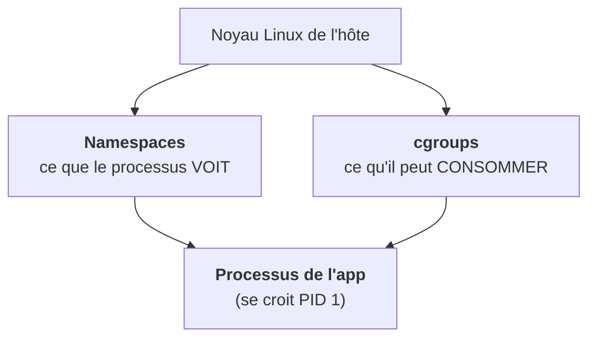
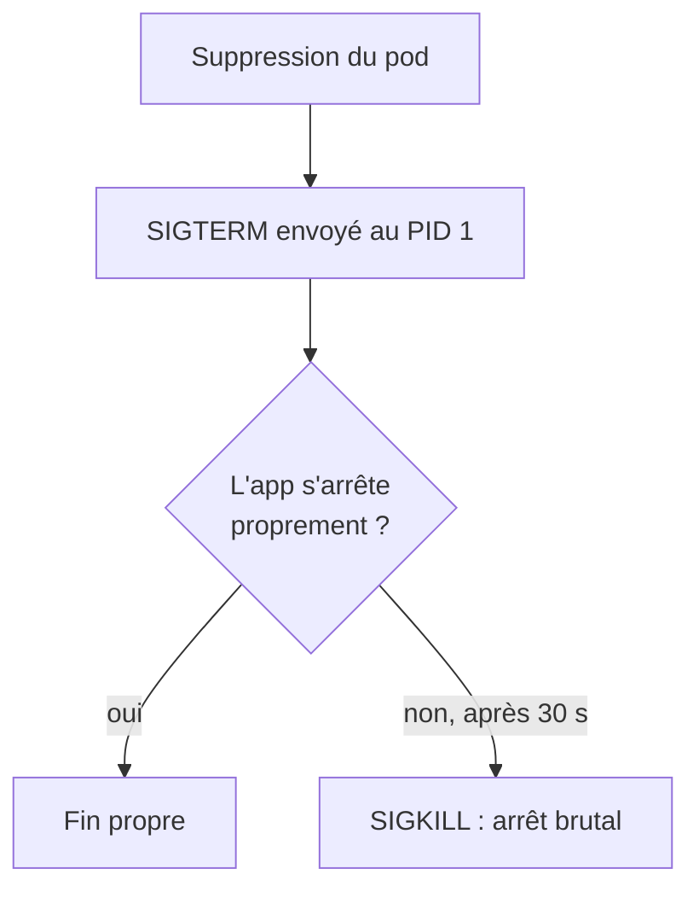

On imagine souvent un conteneur comme une petite machine virtuelle. C'est faux, et cette image fausse rend plusieurs comportements de Kubernetes incompréhensibles.

Un conteneur est un **processus Linux ordinaire**. Il tourne sur le noyau de la machine hôte, comme ton navigateur ou ton shell. Ce qui le rend « conteneur », ce sont deux mécanismes du noyau posés autour de lui.

## Les namespaces : ce qu'il voit

Le processus reçoit sa propre vue du monde : son arbre de processus (il se croit PID 1), sa propre interface réseau, son propre système de fichiers (celui de l'image), ses propres utilisateurs. Il ne voit pas le reste de la machine. Depuis l'hôte, en revanche, on le voit très bien : un `ps aux` sur l'hôte liste le processus nginx d'un conteneur comme n'importe quel autre.

## Les cgroups : ce qu'il peut consommer

Les cgroups plafonnent le CPU, la mémoire et les entrées-sorties. La différence de comportement est importante :

- **CPU au-dessus de la limite** : le processus est ralenti (throttling). Il survit, il rame.
- **Mémoire au-dessus de la limite** : le noyau le tue. Pas de négociation.

C'est exactement ce que tu verras dans Kubernetes. Le champ `resources.limits.memory` d'un pod devient une limite de cgroup, et un pod `OOMKilled` n'est rien d'autre qu'un processus tué par le noyau parce qu'il a dépassé ce plafond. Aucun composant Kubernetes n'a « décidé » de le tuer.

## Le PID 1 reçoit les signaux

Le processus lancé par l'`ENTRYPOINT` de l'image est le PID 1 du conteneur. C'est lui qui reçoit le signal d'arrêt quand Kubernetes supprime un pod :

Si l'application ne gère pas `SIGTERM` (ou si un script shell en PID 1 ne le relaie pas), Kubernetes attend le délai de grâce puis coupe brutalement. Les requêtes en cours sont perdues : un détail qui compte sur un service d'inférence où une réponse peut prendre une minute.

<Piege>
Un script `entrypoint.sh` qui lance l'application sans `exec` garde le shell en PID 1. Le shell reçoit `SIGTERM` et ne le transmet pas : chaque arrêt de pod devient un arrêt brutal après 30 secondes.
</Piege>

<Retenir>
Conteneur = processus + namespaces (ce qu'il voit) + cgroups (ce qu'il consomme). OOMKilled = le noyau a tué un processus qui dépassait sa limite mémoire.
</Retenir>
