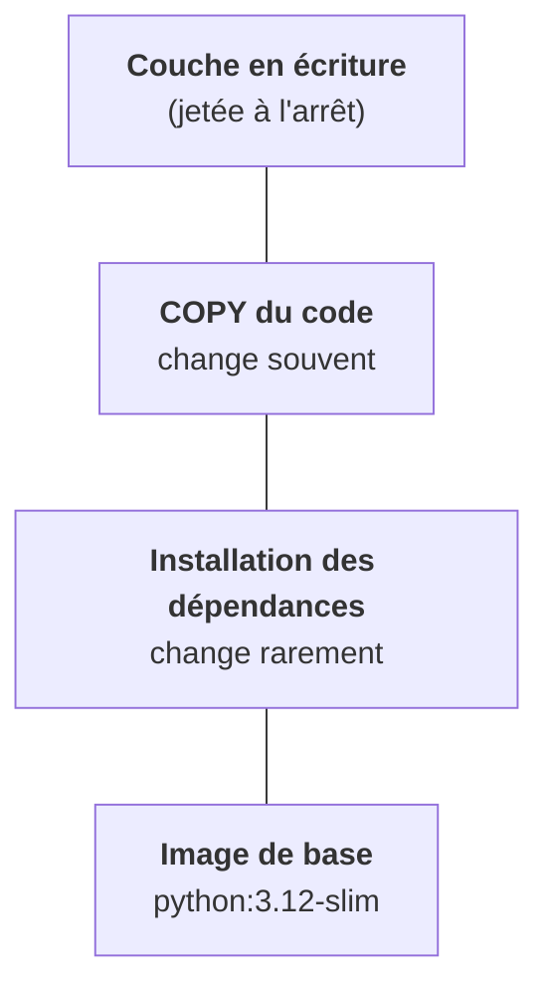

Chez un client, tu vas déployer des dizaines d'images. Trois notions évitent la plupart des surprises : les couches, la différence entre tag et digest, et le nom complet d'une image.

## Une image est une pile de couches

Chaque instruction d'un Dockerfile (`RUN`, `COPY`…) crée une couche en lecture seule. Au démarrage, le runtime ajoute une fine couche en écriture par-dessus, jetée quand le conteneur disparaît.

Deux conséquences pratiques. Les couches sont mises en cache : on place ce qui change rarement en bas. Et deux images qui partagent des couches ne les téléchargent qu'une fois, ce qui compte quand un nœud tire trente images au premier déploiement.

Le **build multi-stage** pousse l'idée plus loin : on compile dans une image lourde, puis on ne copie que le résultat dans une image légère. L'image finale n'embarque ni compilateur ni cache.

## Tag ou digest

`nginx:1.27` est un **tag** : une étiquette mobile, que l'éditeur peut déplacer vers un autre contenu. `nginx@sha256:3f1a…` est un **digest** : l'empreinte du contenu, immuable. Pour un déploiement client reproductible, et surtout en environnement air-gapped où les images sont recopiées dans un registre interne, on finit toujours par raisonner en digests.

## Le nom complet

Un nom d'image complet a la forme `registre/espace/nom:tag`. Quand tu écris `nginx`, le runtime complète en `docker.io/library/nginx:latest`. Chez un client, les images viennent de son registre privé, avec authentification : c'est ce que Kubernetes appelle un `imagePullSecret` (étape 6).

## ENTRYPOINT et CMD, command et args

Dans l'image, `ENTRYPOINT` est le programme et `CMD` ses arguments par défaut. Kubernetes peut surcharger les deux, avec des noms différents :

| Dans l'image | Dans le pod |
|---|---|
| `ENTRYPOINT` | `command:` |
| `CMD` | `args:` |

<Piege>
Mettre des arguments dans `command:` remplace le programme lui-même. Le conteneur essaie alors d'exécuter `--port` comme une commande et meurt aussitôt.
</Piege>

<Retenir>
Tag = étiquette mobile, digest = contenu immuable. `command` remplace l'ENTRYPOINT, `args` remplace le CMD.
</Retenir>
