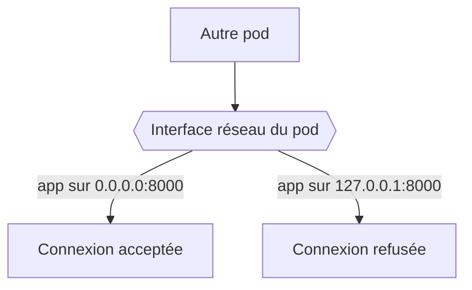
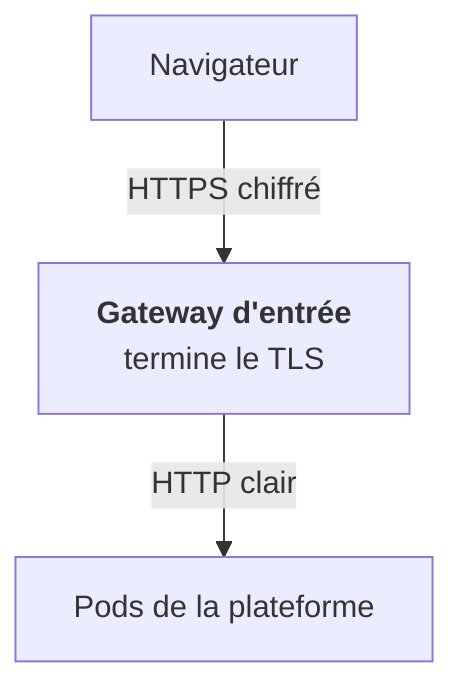

Tu n'as pas besoin d'être ingénieur réseau. Il te faut quatre réflexes, qui reviennent dans presque chaque incident.

## Écouter sur la bonne adresse

Un service écoute sur une adresse et un port. `127.0.0.1` (localhost) n'est joignable que depuis l'intérieur du conteneur. `0.0.0.0` veut dire « toutes les interfaces ».

C'est le bug numéro un du débutant : « ça marche en local, pas dans le cluster ». Le serveur de dev écoute sur localhost par défaut, il faut lui dire `--host 0.0.0.0`.

## Le DNS traduit les noms

Le DNS traduit un nom en adresse IP. Dans Kubernetes, un service interne s'appelle par exemple `postgres.data.svc.cluster.local`, et c'est CoreDNS, à l'intérieur du cluster, qui répond. `nslookup` est disponible presque partout, `dig` donne plus de détails.

## TLS : où le chiffrement s'arrête

Un certificat lie une identité (un nom de domaine) à une clé publique, signée par une autorité de confiance. Trois idées suffisent :

- **La chaîne de confiance** : certificat, puis CA intermédiaire, puis CA racine. Un maillon manquant donne une erreur `unknown authority`.
- **La terminaison TLS** : l'endroit où le chiffrement s'arrête. Chez un client, c'est souvent la gateway d'entrée. Derrière, les pods se parlent en HTTP clair.
- **Voir ce qui est servi** : `curl -v` montre la négociation, `openssl s_client` montre le certificat exact.

## Partir d'un code HTTP

Un diagnostic commence par un code, jamais par « ça marche pas ». `curl -i` affiche le statut : 401, 403, 404, 502, 504 racontent chacun une histoire différente. L'étape 20 en fait une carte complète.

<Retenir>
Écoute sur `0.0.0.0`, pas `127.0.0.1`. Le TLS s'arrête à la gateway, derrière c'est du clair. Tout diagnostic part d'un code HTTP.
</Retenir>
