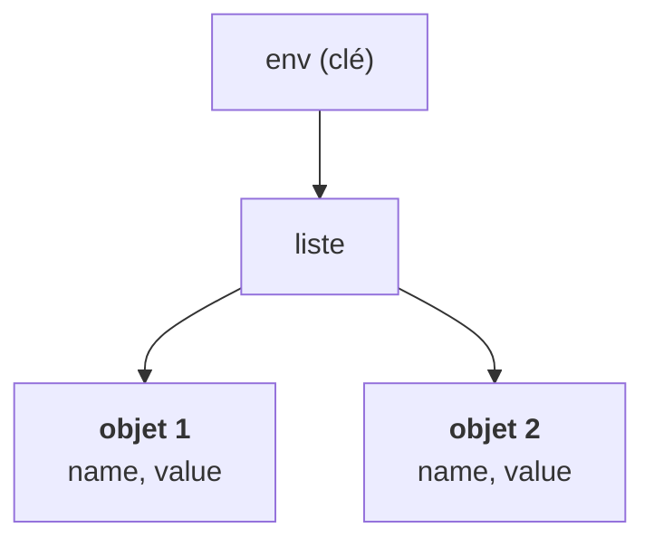

Tu vas lire et écrire du YAML toute la journée. La syntaxe est simple, mais trois pièges reviennent sans cesse.

## La structure en une image

Une liste se note avec `-`, un dictionnaire avec `clé: valeur`. Une liste d'objets mélange les deux, et c'est la forme la plus courante dans Kubernetes :

```yaml
env:              # dictionnaire : la clé env…
  - name: LOG_LEVEL   # …contient une liste ; chaque « - » ouvre un objet
    value: info
  - name: WORKERS
    value: "4"
```



L'indentation se fait en **espaces**, jamais en tabulations, deux par niveau par convention. Un décalage d'un seul espace change le sens du document.

## Le piège des types

YAML devine le type des valeurs, et devine parfois mal :

| Tu écris | YAML comprend |
|---|---|
| `yes`, `no`, `on`, `off` | un booléen |
| `1.10` | le nombre 1.1 |
| `012` | potentiellement un nombre octal |
| `"1.10"` | la chaîne 1.10 |

Règle simple : une valeur qui doit rester une chaîne se met entre guillemets. Dans un **ConfigMap**, toutes les valeurs doivent être des chaînes, donc les nombres aussi : `WORKERS: "4"`.

## Texte sur plusieurs lignes

- `|` conserve les retours à la ligne : scripts, certificats.
- `>` replie le texte en une seule ligne : longues descriptions.

## Plusieurs documents

`---` sépare plusieurs documents dans un même fichier. Un manifeste généré par Helm en contient souvent des dizaines, un par objet.

Le templating Go de Helm viendra à l'étape 7. Inutile de l'aborder avant d'être à l'aise avec le YAML brut : la moitié des erreurs Helm sont des erreurs YAML déguisées.

<Piege>
Un tag d'image comme `tag: 1.10` sans guillemets devient `1.1`, et le pod part en ImagePullBackOff sur une image qui n'existe pas.
</Piege>

<Retenir>
Espaces, jamais de tabulations. Dans le doute, des guillemets. Dans un ConfigMap, toujours des guillemets.
</Retenir>
