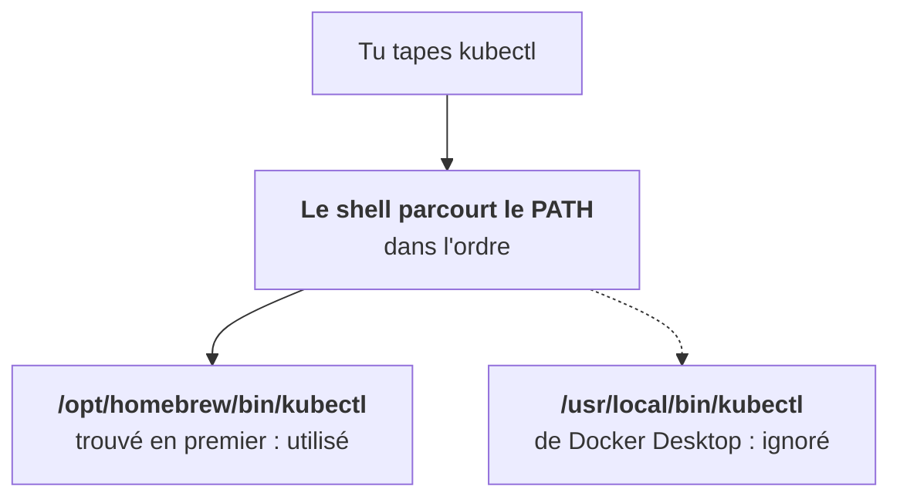

Avant d'écrire la moindre ligne de YAML, il faut une boîte à outils propre. La plupart des « ça marchait hier » viennent d'un outil installé deux fois.

## Qui fait quoi

| Outil | Rôle |
|---|---|
| `kubectl` | parler à l'API Kubernetes |
| `helm` | installer et gérer des charts |
| `k9s` | explorer un cluster en mode texte (étape 19) |
| `kind` | créer un cluster local dans Docker |
| `gcloud` + plugin GKE | accéder aux clusters GCP |
| `uv` | gérer Python sans casser le système |
| `yq`, `jq` | lire et transformer du YAML, du JSON |
| `kubectx`, `kubens` | changer de cluster, de namespace |

## Regarde avant de toucher au shell

Le réflexe à prendre : **avant d'ajouter une ligne dans ton `.zshrc`, regarde ce qui existe déjà.**

`type -a kubectl` liste toutes les copies trouvées. S'il y en a deux (Homebrew, Docker Desktop, gcloud…), c'est la première qui gagne, et ce n'est pas forcément celle que tu viens d'installer. Résous le doublon plutôt que d'empiler des `export PATH=…` à l'aveugle.

## Les versions qui comptent

- **kubectl** doit rester à une version mineure près du cluster. `kubectl version` affiche les deux.
- **Helm 3 uniquement.** Une doc qui parle de Tiller date de Helm 2 : ignore-la.

Chez les clients, tu jongleras entre plusieurs clusters. `kubectx` et `kubens` rendent le changement de contexte explicite, et la plupart des prompts de shell peuvent afficher le contexte actif en permanence. C'est la meilleure protection contre une commande lancée sur le mauvais cluster.

<Retenir>
`type -a` avant tout `export PATH`. kubectl à une mineure près du cluster. Helm 3, jamais Tiller.
</Retenir>
