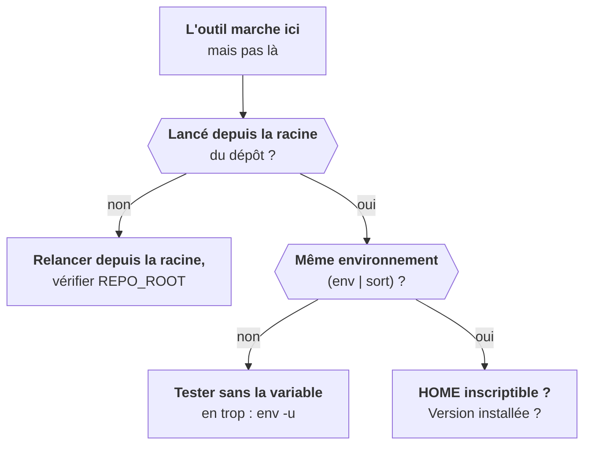

Ces cas sont tirés du terrain. Ils font perdre des heures quand on ne les reconnaît pas, et deux minutes quand on les a déjà vus.

## L'outil dépend du dossier courant

Certains scripts internes cherchent leur configuration à partir du dossier courant ou d'une variable comme `REPO_ROOT`. Lance-les depuis la racine du dépôt, et vérifie la variable avant de conclure que l'outil est cassé.

## Une variable d'environnement parasite

Les harnais d'agents IA (Claude Code, Cursor…) posent des variables comme `AGENT=1` dans le shell qu'ils ouvrent. Un outil qui valide sa configuration en lisant toutes les variables d'un préfixe échoue alors avec un message sans rapport. Compare `env | sort` entre les deux terminaux, puis relance avec `env -u AGENT`.

## Un $HOME en lecture seule

Dans un conteneur lancé avec un utilisateur arbitraire (OpenShift le fait par défaut), `$HOME` pointe vers un dossier non inscriptible. Helm et kubectl refusent de démarrer parce qu'ils veulent écrire leur cache. Contournement rapide : `HOME=/tmp`. Version propre : `HELM_CACHE_HOME`, `HELM_CONFIG_HOME` et `KUBECONFIG` vers un dossier inscriptible.

## Une installation qui retarde

Un outil Python interne exige souvent une version précise de Python. `uv sync` respecte cette contrainte. Après un `git pull` de l'outil, `uv sync --reinstall` évite les erreurs fantômes d'une ancienne version restée installée.

## La doc est périmée

Quand la doc cite une option qui n'existe plus, ne force pas. Note l'écart (« doc : version N, installé : N+3, option remplacée par… »), fais marcher avec la version réelle, propose le correctif.

<Retenir>
Avant de dire « l'outil est cassé » : dossier courant, variables d'environnement, `$HOME` inscriptible, version installée. Et un écart de doc se note, il ne se cache pas.
</Retenir>
