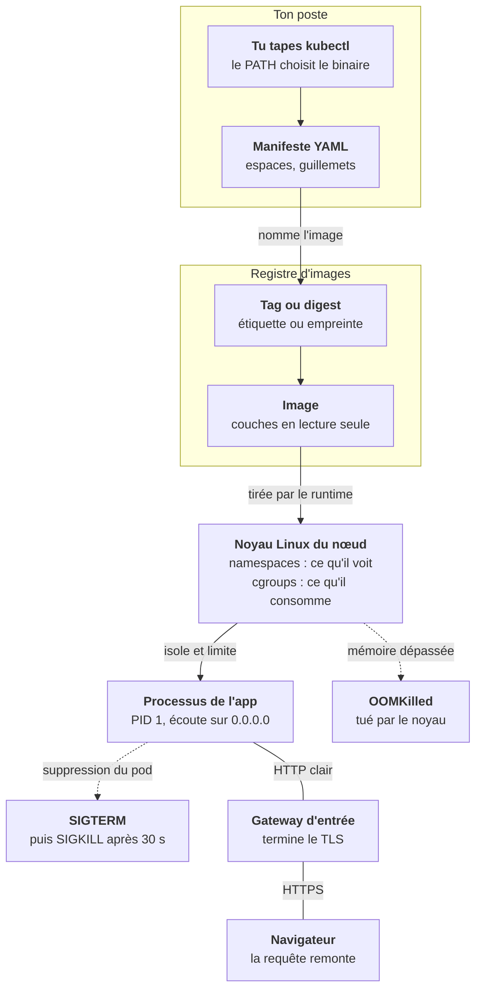
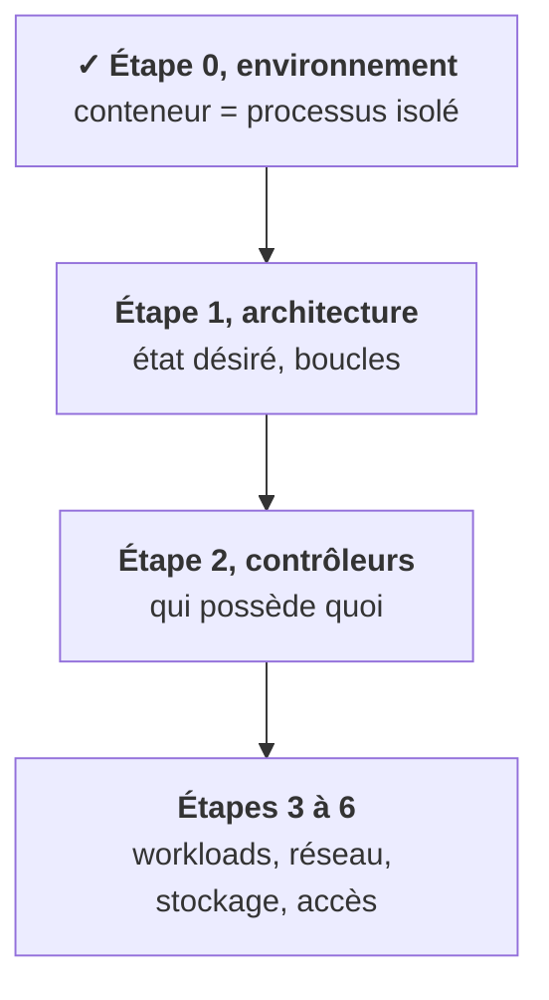

L'étape 0 a posé des briques qui semblaient séparées : les outils, le YAML, les images, le noyau, le réseau. Mises bout à bout, elles racontent le chemin d'une application, **de ta commande jusqu'au processus qui répond**. Kubernetes viendra s'insérer au milieu à l'étape 1.

## Ce que tu sais faire maintenant

- **Expliquer un conteneur** : un processus, des namespaces, des cgroups, et ce que veut dire `OOMKilled`. [Leçon 1](/l/00-environnement/01-conteneur-processus/)
- **Lire un nom d'image** : couches, tag ou digest, `command` et `args`. [Leçon 2](/l/00-environnement/02-images-couches/)
- **Poser les bons réflexes réseau** : `0.0.0.0`, DNS, terminaison TLS, code HTTP. [Leçon 3](/l/00-environnement/03-reseau-minimum/)
- **Écrire du YAML** qui ne te piège pas. [Leçon 4](/l/00-environnement/04-yaml-pieges/)
- **Savoir quel outil s'exécute**, et lequel de tes clusters tu vises. [Leçon 5](/l/00-environnement/05-outillage-path/)
- **Diagnostiquer un outil qui marche ici mais pas ailleurs.** [Leçon 6](/l/00-environnement/06-pieges-terrain/)

## Où tu en es dans la partie A

Dans ce schéma, il manque encore le chef d'orchestre : qui décide sur quel nœud lancer l'image, et qui la relance quand le processus meurt. C'est l'objet de l'étape 1.

<Retenir>
Un conteneur est un processus isolé et limité par le noyau, lancé depuis une image en couches que l'on désigne idéalement par son digest. Il doit écouter sur `0.0.0.0` et s'arrêter proprement sur `SIGTERM`. Et avant d'accuser un outil, vérifie lequel s'exécute, et depuis où.
</Retenir>
