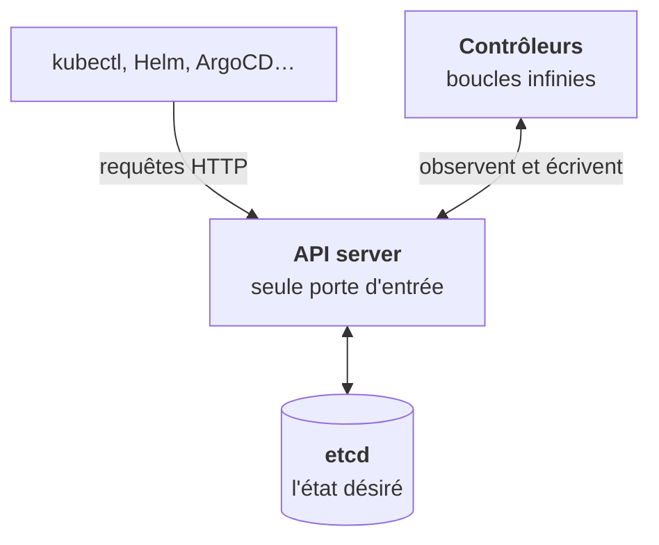
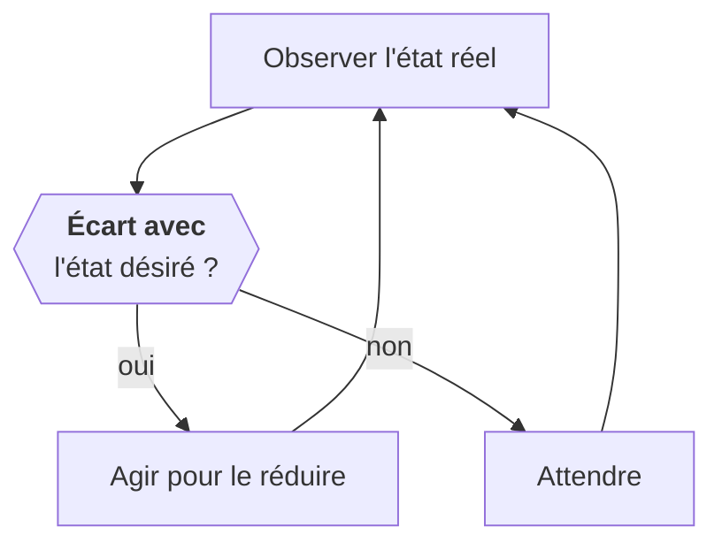

Oublie l'image d'un « orchestrateur qui lance des conteneurs ». Le modèle mental juste tient en trois pièces.

1. Une **base de données**, etcd, contient des objets qui décrivent un **état désiré** : « je veux trois réplicas de cette image ».
2. Une **API**, l'API server, est la seule porte d'entrée pour lire ou écrire ces objets. `kubectl` ne fait rien d'autre que des appels HTTP à cette API.
3. Des **contrôleurs**, des boucles infinies, comparent en permanence l'état désiré à l'état observé et agissent pour combler l'écart.

Ce mécanisme s'appelle la **réconciliation**.

## Tu décris, tu n'ordonnes pas

Conséquence fondamentale : **tu ne demandes jamais à Kubernetes de faire quelque chose, tu lui décris ce que tu veux obtenir.**

Si tu supprimes un pod géré par un Deployment, le contrôleur constate qu'il manque un pod et en recrée un. De ton point de vue, ta commande « n'a pas marché ». Du point de vue du système, tout fonctionne : l'état désiré dit trois pods, il y en a de nouveau trois.

C'est aussi ce qui rend Kubernetes robuste. Un nœud tombe ? Les pods qu'il portait manquent, les contrôleurs en recréent ailleurs. Personne n'a écrit de script « si un nœud tombe, alors… ».

## Pourquoi ça compte chez un client

Toute action manuelle sur un objet qu'un contrôleur gère sera, tôt ou tard, annulée. Avant de modifier ou supprimer quoi que ce soit, la question à se poser est : **qui gère cet objet, et quel état désiré va-t-il rétablir ?** L'étape 2 est entièrement consacrée à cette question.

<Retenir>
etcd stocke l'état désiré, l'API server est la seule porte, les contrôleurs réconcilient en boucle. Tu décris un résultat, tu ne donnes pas d'ordres.
</Retenir>
