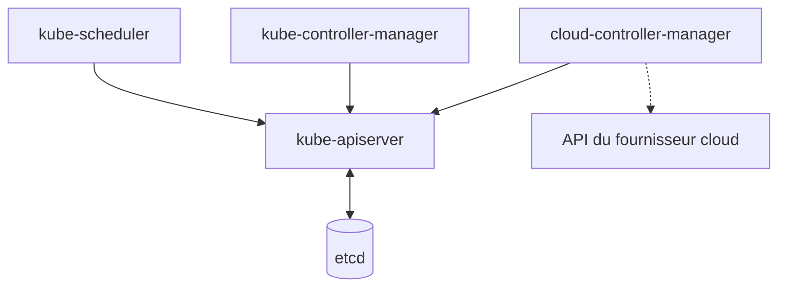

Le **control plane** est l'ensemble des composants qui gèrent le cluster. Sur ton cluster kind, ils tournent tous sur le nœud unique. Chez un client, ils sont sur des nœuds dédiés, ou gérés par le cloud : sur GKE, tu ne les vois même pas.

## Ce que fait chacun, et ce qui casse

| Composant | Rôle | S'il tombe |
|---|---|---|
| **kube-apiserver** | Valide, authentifie, autorise chaque requête, lit et écrit dans etcd | Plus de kubectl, plus de contrôleurs. Les pods lancés continuent |
| **etcd** | Base clé-valeur, tout l'état du cluster | Pareil. Si ses données sont perdues, le cluster est perdu |
| **kube-scheduler** | Choisit un nœud pour chaque pod qui n'en a pas | Les nouveaux pods restent `Pending` |
| **kube-controller-manager** | Héberge les contrôleurs intégrés (Deployment, ReplicaSet, Job…) | Plus rien ne se répare ni ne scale |
| **cloud-controller-manager** | Lien avec le fournisseur : LoadBalancers, disques | Un Service LoadBalancer reste `<pending>` |

## Le point clé : un seul composant parle à etcd

**L'API server est le seul à lire et écrire dans etcd.** Le scheduler, les contrôleurs et les kubelets ne parlent qu'à l'API server.

C'est ce qui rend Kubernetes extensible. Un opérateur (étape 9) n'est qu'un contrôleur de plus qui observe l'API et y écrit. Il n'a besoin d'aucun accès privilégié à la base, et il ne se distingue en rien des contrôleurs intégrés.

C'est aussi pourquoi les sauvegardes d'etcd comptent autant : c'est le seul endroit où l'état du cluster existe. On y reviendra avec la continuité de service, à l'étape 17.

<Piege>
Le LoadBalancer en `<pending>` est un classique on-prem : le chart demande un équilibreur, mais personne dans le cluster ne sait en fournir. Ce n'est pas un bug du chart, c'est une frontière de responsabilité avec le client (étape 10).
</Piege>

<Retenir>
API server = la porte, etcd = la mémoire, scheduler = le placement, controller-manager = la réparation. Seul l'API server touche à etcd.
</Retenir>
