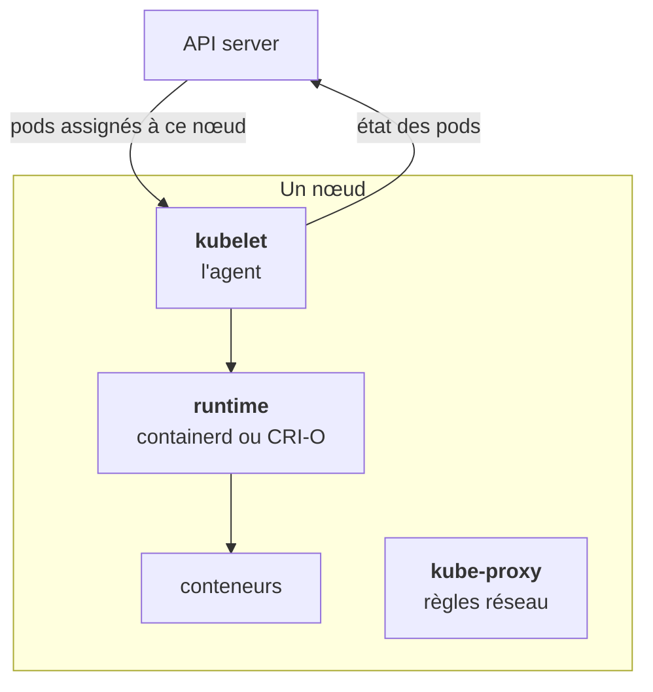

Un **nœud** est une machine, virtuelle ou physique, qui fait tourner des pods. Chacun porte trois composants.

## Le kubelet, l'agent du nœud

Le kubelet surveille l'API server. Pour chaque pod assigné à **son** nœud, il demande au runtime de lancer les conteneurs, exécute les probes (liveness, readiness), puis remonte l'état du pod.

Il ne prend aucune décision d'orchestration. Il ne choisit pas où placer un pod, il ne décide pas d'en créer un nouveau. Il exécute ce que l'API dit pour son nœud. Si l'API server devient injoignable, le kubelet continue de faire tourner ce qu'il a déjà, mais ne reçoit plus rien de nouveau.

## Le runtime

containerd, le plus courant, ou CRI-O (souvent sur OpenShift). Il télécharge les images et crée les conteneurs. **Docker n'est plus utilisé comme runtime depuis Kubernetes 1.24**, mais les images restent les mêmes : un client qui n'a « pas Docker » fera tourner tes images sans problème.

## kube-proxy

Il configure les règles réseau du nœud (iptables ou IPVS) pour que l'IP stable d'un Service redirige vers les pods qui sont derrière. Certains CNI, comme Cilium, le remplacent entièrement. L'étape 4 détaille ce qu'il fait vraiment, et surtout ce qu'il ne fait pas.

## Ce qui en découle pour le diagnostic

Un problème qui ne touche qu'**un** nœud (pods en échec seulement là, images qui ne se tirent pas, pression disque) se lit dans `kubectl describe node`, section Conditions. Un problème qui touche tous les nœuds se cherche plutôt côté control plane ou configuration.

<Retenir>
Le kubelet exécute, il ne décide pas. Le runtime tire et lance les images. kube-proxy fait marcher les Services. Docker n'est plus le runtime, les images restent compatibles.
</Retenir>
