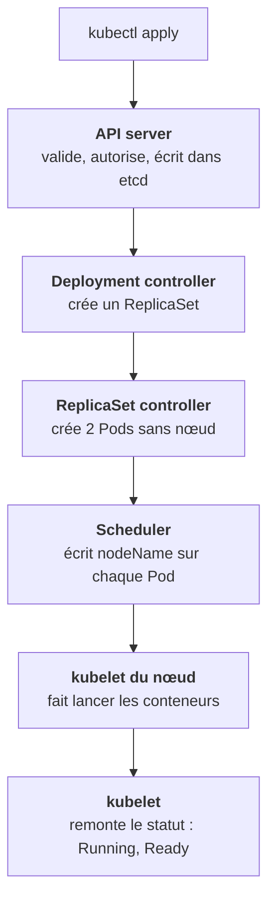

C'est **le** schéma à avoir en tête. Tu appliques un Deployment qui demande deux réplicas. Voici ce qui se passe.

Chaque flèche est un acteur indépendant, qui ne connaît que l'API. Le Deployment controller ne sait rien du scheduler, le scheduler ne sait rien du kubelet. Chacun observe un type d'objet, réagit, et écrit un autre objet. **Personne ne pilote l'ensemble.**

## Les cinq étapes, une par une

1. **API server** : vérifie que le manifeste est valide et que tu as le droit, puis enregistre le Deployment.
2. **Deployment controller** : voit un nouveau Deployment, crée un ReplicaSet avec `replicas: 2`.
3. **ReplicaSet controller** : voit un ReplicaSet à 2 et 0 pod, crée deux objets Pod. Ils n'ont pas encore de nœud.
4. **Scheduler** : voit deux pods sans `nodeName`, choisit un nœud pour chacun selon les ressources et les contraintes.
5. **kubelet** : voit un pod assigné à son nœud, demande au runtime de tirer l'image et de lancer le conteneur, puis remonte le statut.

## La même chaîne sert à diagnostiquer

Quand un pod ne démarre pas, tu remontes ce trajet :

| Question | Si non, ça bloque chez |
|---|---|
| Le pod existe-t-il ? | Deployment ou ReplicaSet controller (quota, droits) |
| A-t-il un nœud ? | Scheduler (`FailedScheduling`) |
| L'image est-elle tirée ? | kubelet et runtime (`ErrImagePull`) |
| Le conteneur tient-il debout ? | L'application (`CrashLoopBackOff`) |

Le champ `status` et les **Events** de `kubectl describe` te disent à quelle étape ça s'arrête.

<Retenir>
apply, API server, Deployment controller, ReplicaSet controller, scheduler, kubelet. Pour diagnostiquer un pod, trouve l'étape où la chaîne s'arrête.
</Retenir>
