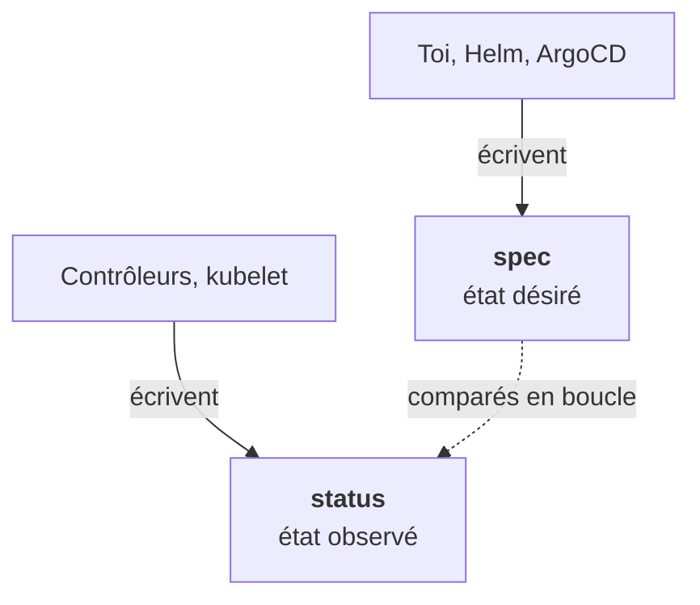

Tout objet Kubernetes, du Pod à la ressource la plus exotique d'un opérateur, a la même forme. Une fois qu'on l'a vue, on lit n'importe quel manifeste.

```yaml
apiVersion: apps/v1     # groupe/version qui définit ce type
kind: Deployment        # le type d'objet
metadata:               # identité : nom, namespace, labels, annotations
  name: web
  namespace: default
spec:                   # ÉTAT DÉSIRÉ : ce que tu écris
  replicas: 2
status:                 # ÉTAT OBSERVÉ : ce que les contrôleurs écrivent
  readyReplicas: 2
```



## spec t'appartient, status non

`spec` est ce que tu demandes. `status` est ce que les contrôleurs constatent. Tu n'écris jamais `status`. La réconciliation, c'est précisément l'écart entre les deux : `replicas: 3` dans spec, `readyReplicas: 2` dans status, un contrôleur travaille.

## apiVersion, le groupe de l'API

| apiVersion | Objets |
|---|---|
| `v1` | Pod, Service, ConfigMap, Secret, Namespace |
| `apps/v1` | Deployment, StatefulSet, DaemonSet |
| `batch/v1` | Job, CronJob |
| `networking.k8s.io/v1` | Ingress, NetworkPolicy |

Quand un client a un vieux cluster, ce sont ces versions qui posent des problèmes de compatibilité : une API retirée dans une version récente, ou pas encore disponible dans une ancienne (étape 10).

## La vérité est dans le cluster

`kubectl get … -o yaml` montre l'objet tel que l'API le stocke, y compris toutes les **valeurs par défaut** que tu n'as pas écrites (`strategy`, `progressDeadlineSeconds`…). C'est souvent là qu'on comprend un comportement surprenant.

`kubectl explain` donne la documentation de n'importe quel champ, **pour la version réellement installée**. C'est plus fiable que la doc en ligne, qui décrit peut-être une autre version.

`kubectl api-resources` liste tous les types disponibles, y compris les CRDs installées. Sur un cluster client inconnu, c'est une des premières commandes à lancer.

<Retenir>
apiVersion + kind disent le type, metadata l'identité, spec ce que tu veux, status ce qui est. `-o yaml` et `explain` disent la vérité du cluster.
</Retenir>
