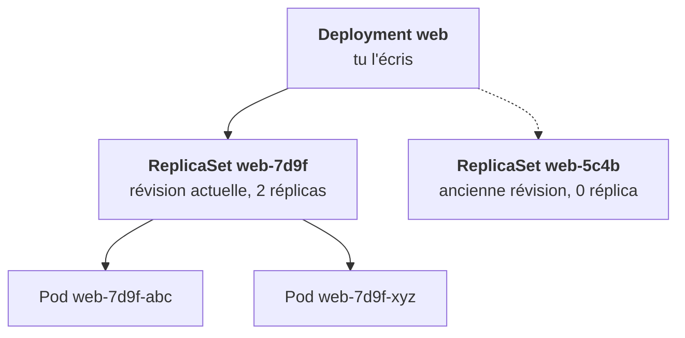
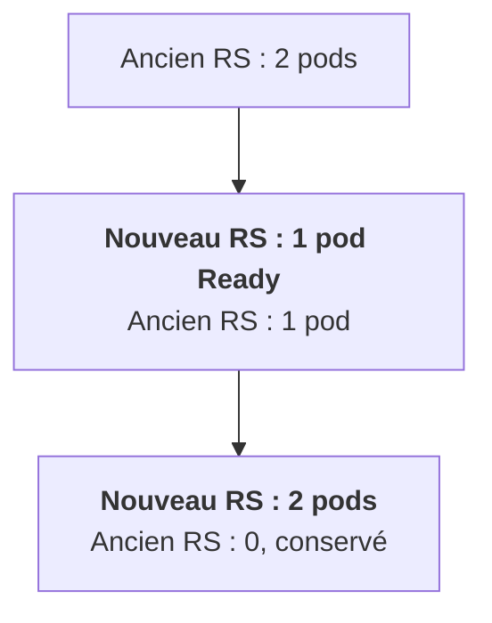

Trois objets s'emboîtent. Tu en manipules un seul, le Deployment, mais il faut comprendre les deux autres pour lire ce que tu vois dans le cluster.

## Pod : la plus petite unité, et elle est mortelle

Un pod, c'est un ou plusieurs conteneurs qui partagent la même IP, le même réseau et les mêmes volumes. Dans la grande majorité des cas : un conteneur principal, parfois un sidecar ou des init containers.

Un pod est **mortel**. Son IP est éphémère, il ne se déplace jamais d'un nœud à l'autre, et quand il meurt, on en crée un autre, avec un autre nom et une autre IP. **Tu ne crées presque jamais un pod à la main** : personne ne le recréerait s'il disparaissait.

## ReplicaSet : maintenir N copies

Il garantit qu'il existe N pods identiques. Tu ne le manipules pas directement. Son nom porte un suffixe de hash (`web-7d9f`), que tu retrouves dans le nom de ses pods.

## Deployment : ce que tu utilises vraiment

Pour une application sans état, c'est l'objet de référence. Quand tu changes l'image, le Deployment ne modifie pas les pods existants : il crée un **nouveau ReplicaSet**, le monte progressivement, et descend l'ancien.

Deux bénéfices. Si la nouvelle version ne démarre pas, les anciens pods restent là et servent toujours. Et l'ancien ReplicaSet, conservé à zéro, permet un **rollback** immédiat.

Le lien entre un Deployment et ses pods, c'est son `selector` : les labels de pods qu'il revendique. Le `template` contient le modèle de pod, dont les labels doivent correspondre au selector.

<Retenir>
On écrit un Deployment, jamais un pod seul. Une mise à jour = un nouveau ReplicaSet monté progressivement ; l'ancien reste à 0 pour le rollback.
</Retenir>
