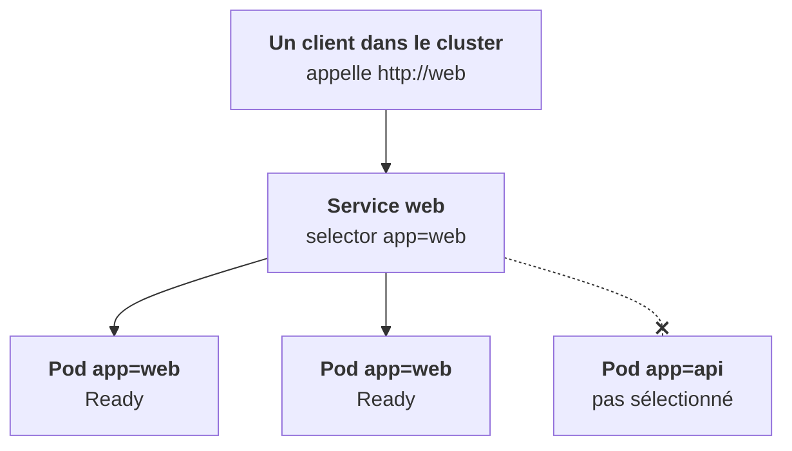

Un pod a une IP éphémère. Si le client de ton API devait connaître l'IP de chaque pod, il serait cassé à chaque redémarrage. Le **Service** règle ce problème.

## Une adresse stable devant des pods mortels

Un Service donne une IP et un nom DNS **stables** à un groupe de pods. Il répartit le trafic entre ceux qui sont `Ready`. Depuis n'importe quel pod du même namespace, `http://web` suffit ; depuis ailleurs, `http://web.default.svc.cluster.local`.

Les types de Service (ClusterIP, NodePort, LoadBalancer) viendront à l'étape 4. Ici, retiens la mécanique.

## Les labels, seul lien entre les objets

Un **label** est une paire clé-valeur posée sur `metadata.labels`, faite pour être **sélectionnée**. C'est le seul mécanisme qui relie :

- un Deployment à ses pods ;
- un Service à ses pods ;
- une NetworkPolicy à ses cibles.

Il n'y a pas de référence par nom ni par identifiant. Si le selector du Service dit `app: web` et que les pods portent `app: webb`, le Service ne cible rien, sans aucune erreur.

## Annotations : de la métadonnée, pas de la sélection

Une **annotation** est aussi une paire clé-valeur, mais elle n'est pas sélectionnable. Elle porte de l'information pour les outils : réglages d'un ingress controller, empreinte d'un ConfigMap pour forcer un redémarrage, informations de Helm ou d'ArgoCD.

## La convention à reconnaître

Les charts Helm utilisent des labels standard : `app.kubernetes.io/name`, `app.kubernetes.io/instance`, `app.kubernetes.io/component`. Sur un cluster client, filtrer par `app.kubernetes.io/instance=<release>` te donne tout ce qu'une release a créé.

<Piege>
Un Service sans cible ne renvoie pas d'erreur explicite : les connexions échouent, c'est tout. Le premier réflexe est de comparer son selector avec `kubectl get pods --show-labels`.
</Piege>

<Retenir>
Service = adresse stable devant des pods qui changent. Labels = seul lien entre objets, à sélectionner. Annotations = métadonnées pour les outils.
</Retenir>
