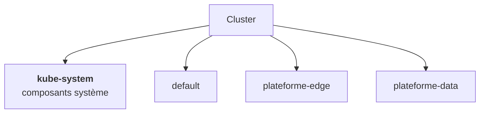
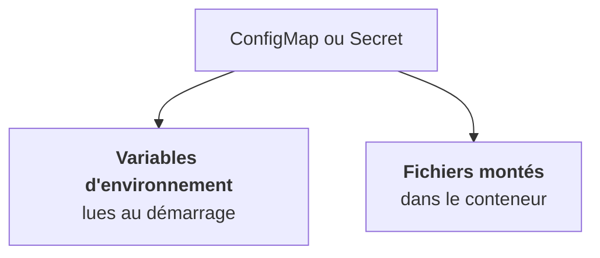

Trois objets simples, qu'on retrouve dans tous les charts.

## Namespace : une partition du cluster

Un namespace est une partition logique. Les noms d'objets y sont uniques : deux Deployments `api` peuvent coexister dans deux namespaces. On s'en sert pour séparer les applications et pour y accrocher des quotas, des droits (RBAC) et des politiques réseau.

Une plateforme LLM chez un client occupe typiquement plusieurs namespaces, un par plan ou par famille de composants. Le namespace `default` existe toujours ; les composants système sont dans `kube-system`.

## ConfigMap et Secret : sortir la configuration de l'image

Une image ne doit pas contenir la configuration d'un client. Deux objets la portent à côté :

| | ConfigMap | Secret |
|---|---|---|
| Contenu | paires clé-valeur en clair | paires clé-valeur encodées en base64 |
| Usage | URL, niveaux de log, options | mots de passe, clés, certificats |
| Protection | RBAC | RBAC, **pas** l'encodage |

Dans un ConfigMap, toutes les valeurs sont des chaînes (souviens-toi des guillemets en YAML). Les deux se consomment de la même façon :

La différence compte : une variable d'environnement est figée au démarrage du conteneur, un fichier monté est mis à jour quand l'objet change (avec un léger délai). Si l'application ne relit pas sa configuration, il faut redémarrer les pods dans les deux cas.

<Piege>
base64 n'est pas du chiffrement. `echo … | base64 -d` révèle un Secret en une seconde. Ce qui le protège, c'est le RBAC, et éventuellement le chiffrement d'etcd côté cluster. L'étape 6 revient sur Vault, External Secrets et la bonne hygiène.
</Piege>

<Retenir>
Un namespace partitionne les noms et porte quotas, droits et règles réseau. ConfigMap et Secret ont la même forme ; un Secret est protégé par le RBAC, pas par son encodage.
</Retenir>
