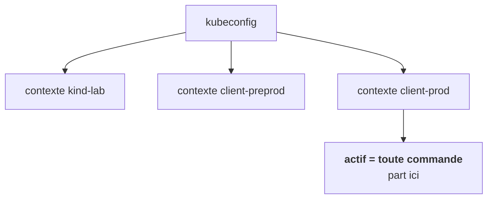
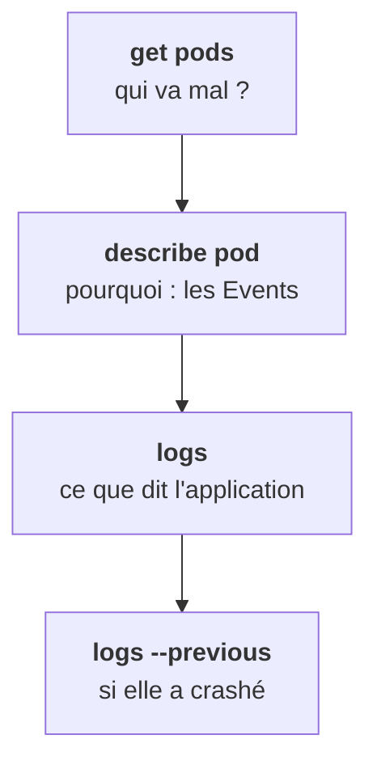

Quatre-vingt-dix pour cent du travail quotidien tient en quelques commandes. Pas besoin de les taper maintenant : retiens à quoi elles servent et dans quel ordre on les dégaine.

## D'abord, savoir où on est

Le fichier `~/.kube/config` (ou la variable `KUBECONFIG`) contient des clusters, des identités et des **contextes**, c'est-à-dire des couples cluster + identité + namespace. Chez les clients, tu en manipuleras plusieurs.

**Avant toute commande qui modifie, vérifie le contexte actif.** C'est la façon la plus classique de casser une production : on croit être sur la preprod.

## Lire : du plus large au plus précis

- `get` donne le tableau. `-A` pour tous les namespaces, `-o wide` pour le nœud et l'IP, `-l` pour filtrer par label, `-w` pour suivre en direct.
- `describe` est **le premier réflexe sur un pod qui va mal**. La section Events, tout en bas, raconte ce que le scheduler, le kubelet et le runtime ont tenté, et pourquoi ça a échoué.
- `logs` donne la sortie du conteneur. `-c` pour choisir un conteneur dans un pod qui en a plusieurs (init container, sidecar). `-f` pour suivre.

## --previous, la commande qui fait gagner du temps

Sur un pod en `CrashLoopBackOff`, les logs de l'instance courante sont souvent vides : elle vient de redémarrer. L'erreur est dans **l'instance précédente**. `kubectl logs <pod> --previous`.

## Entrer dans le pod

`kubectl exec -it <pod> -- sh` ouvre un shell. `kubectl port-forward` joint un pod ou un Service depuis ta machine, sans rien exposer. Les deux servent à tester de l'intérieur, sans passer par l'ingress.

<Retenir>
Contexte d'abord. Puis get, describe (les Events), logs, et `--previous` dès qu'il y a un crash.
</Retenir>
