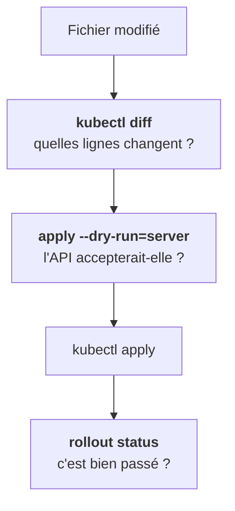
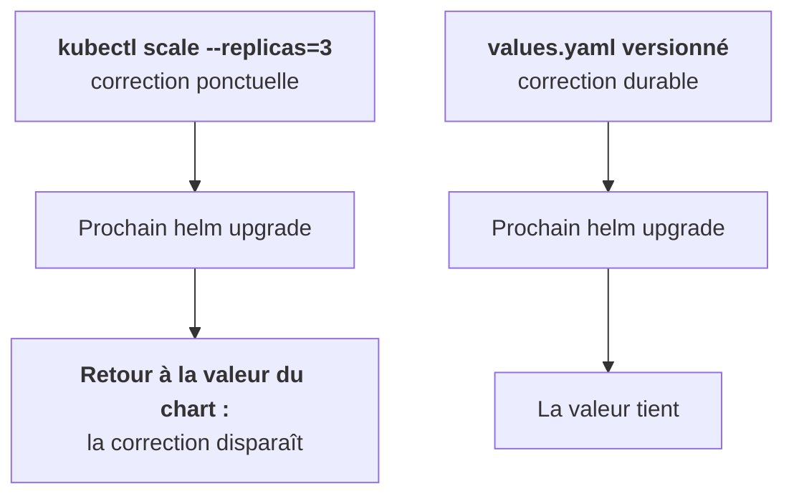

Lire est sans risque. Écrire sur le cluster d'un client, beaucoup moins. Deux habitudes changent tout : prévisualiser, et passer par des fichiers.

## Prévisualiser avant d'appliquer

- `kubectl diff` compare ton fichier à l'objet réel et montre les lignes qui changeraient. Si tu ne t'attendais qu'à une ligne et que tu en vois vingt, arrête-toi.
- `--dry-run=server` fait passer la requête par toute la validation de l'API server, contrôleurs d'admission compris, sans rien enregistrer.
- `rollout status` attend la fin du déploiement, et `rollout undo` revient en arrière si besoin.

## Impératif ou déclaratif

`kubectl create deployment`, `kubectl scale`, `kubectl edit` sont **impératifs** : pratiques pour tester, mais ils ne laissent aucune trace dans un fichier.

Chez un client, **tout passe par des fichiers versionnés** (Helm, étape 7). Une modification à la main sera écrasée au prochain déploiement, ou pire, elle restera et personne ne saura pourquoi le cluster ne correspond plus au dépôt. Une commande impérative n'est acceptable que comme correctif d'urgence, immédiatement reportée dans les fichiers. C'est la distinction « ponctuel ou durable » que l'étape 2 développe.

## Extraire un champ

`-o yaml` montre tout l'objet. Pour un seul champ, `-o jsonpath='…'` ou `-o json | jq`. Utile pour scripter, ou pour copier une valeur sans l'afficher en clair.

<Retenir>
diff, dry-run serveur, apply, rollout status. Une modification impérative est une rustine : la vraie correction va dans les fichiers versionnés.
</Retenir>
