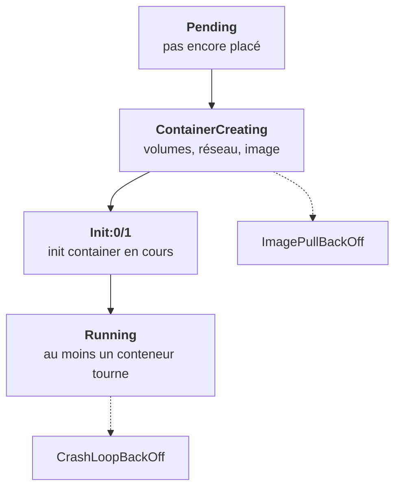

La colonne `STATUS` de `kubectl get pods` condense beaucoup d'information en un mot. Il faut savoir lire ces mots, et savoir où regarder pour chacun.

## Les statuts à reconnaître

| Statut | Signification | Où regarder |
|---|---|---|
| `Pending` | Pas encore placé, ou image en téléchargement | `describe`, Events (`FailedScheduling`) |
| `ContainerCreating` | Le kubelet prépare le conteneur | Normal quelques secondes, sinon `describe` |
| `Init:0/1` | Un init container tourne encore | `logs -c <init>` |
| `Running` | Au moins un conteneur tourne | Vérifie aussi READY |
| `CrashLoopBackOff` | Démarre, meurt, réessaie de plus en plus tard | `logs --previous` |
| `ImagePullBackOff` | Image introuvable ou registre refusé | `describe`, Events |
| `OOMKilled` | Tué pour dépassement mémoire (dans Last State) | Limite ou application |
| `Completed` | Un Job a terminé | Normal |
| `Terminating` | En cours de suppression | Bloqué : souvent un finalizer |

## Les trois autres colonnes

- **READY** (`1/1`) : combien de conteneurs sont prêts à recevoir du trafic. `Running 0/1` veut dire que le conteneur tourne mais que sa readiness probe échoue, donc qu'aucun Service ne lui envoie de requêtes.
- **RESTARTS** : un pod `Running 1/1` avec 47 redémarrages n'est pas sain. Il crashe et repart en boucle.
- **AGE** : un pod de 30 secondes dans un Deployment qui tourne depuis des jours a été recréé. Pourquoi ?

## Le bon outil selon le statut

Si le conteneur n'a jamais démarré (Pending, ImagePullBackOff, ContainerCreating qui dure), il n'y a **pas de logs** : la réponse est dans les Events de `describe`. S'il a démarré puis est mort (CrashLoopBackOff, restarts), la réponse est dans `logs --previous`.

La méthode complète de diagnostic est à l'étape 20. Ici, il s'agit de reconnaître les mots.

<Retenir>
Jamais démarré : describe et ses Events. Démarré puis mort : logs --previous. Running ne veut pas dire sain : regarde READY et RESTARTS.
</Retenir>
