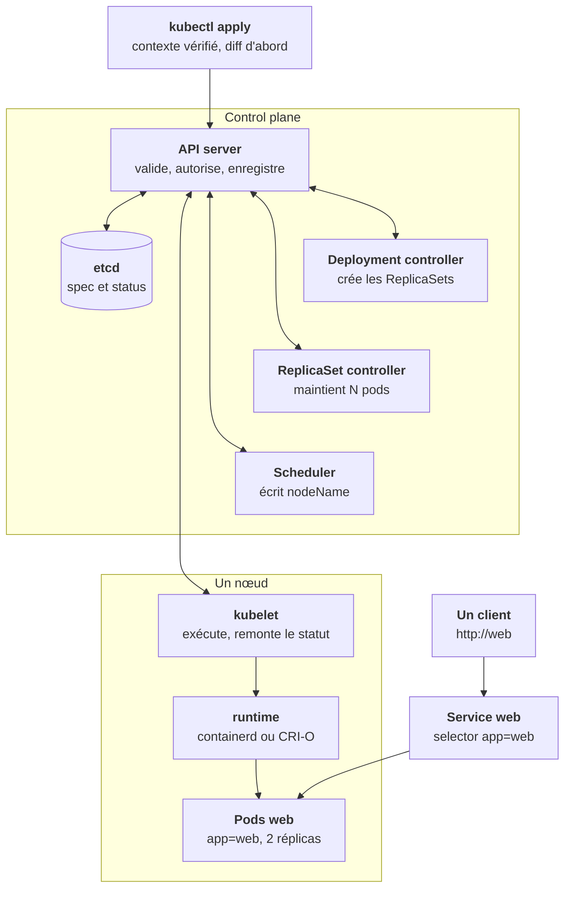
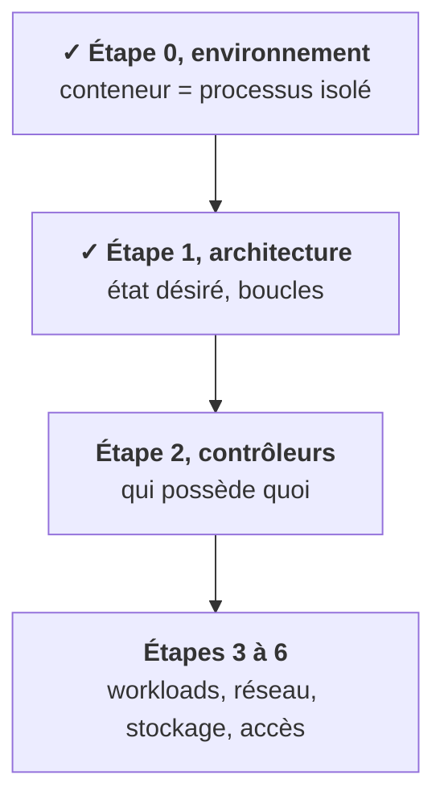

À la leçon 4, le trajet d'un `kubectl apply` était dessiné comme une chaîne. La réalité est plus simple et plus surprenante : **aucun composant ne parle à un autre, tous parlent à l'API server**. Chacun observe un type d'objet, réagit, et écrit son résultat dans l'API. Suis le déploiement de `web` (2 réplicas) pas à pas.

## Ce que tu sais faire maintenant

- **Expliquer le modèle** : une base de données (etcd), une porte (l'API server), et des robots qui réconcilient. [Leçon 1](/l/01-architecture/01-base-et-robots/)
- **Situer chaque composant**, côté control plane et côté nœud. [Leçons 2](/l/01-architecture/02-control-plane/) et [3](/l/01-architecture/03-noeuds/)
- **Suivre un apply de bout en bout**, et s'en servir pour trouver où un pod bloque. [Leçon 4](/l/01-architecture/04-trajet-apply/)
- **Lire un objet** : `metadata`, `spec`, `status`. [Leçon 5](/l/01-architecture/05-anatomie-objet/)
- **Emboîter Deployment, ReplicaSet et Pod**, et faire un rollback. [Leçon 6](/l/01-architecture/06-pod-replicaset-deployment/)
- **Relier les objets par les labels** : Service, selector, annotations. [Leçon 7](/l/01-architecture/07-service-labels/)
- **Ranger et configurer** : namespaces, ConfigMaps, Secrets. [Leçon 8](/l/01-architecture/08-namespace-configmap-secret/)
- **Utiliser kubectl** pour lire, puis pour modifier sans casser, et lire un statut de pod. [Leçons 9](/l/01-architecture/09-kubectl-lire/), [10](/l/01-architecture/10-kubectl-ecrire/) et [11](/l/01-architecture/11-statuts-pod/)

## Où tu en es dans la partie A

Tu sais maintenant que des boucles réparent sans cesse le cluster. L'étape 2 répond à la question qui suit : quand une boucle annule ton geste, **qui est-elle, et où agir pour qu'elle te suive ?**

<Retenir>
Tout passe par l'API server, et tout est écrit dans etcd. Chaque contrôleur observe, compare à l'état désiré, et corrige, sans fin. Pour diagnostiquer, suis le trajet et trouve l'étape où il s'arrête.
</Retenir>
