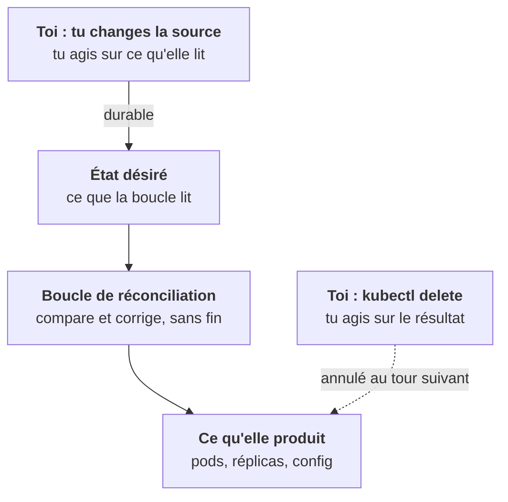

Tu l'as vu au lab de l'étape 1 : tu supprimes un pod, un autre apparaît aussitôt. Sur un cluster client, cette situation a mille variantes, et elles font perdre des heures à qui ne la reconnaît pas.

## Les variantes du même problème

- tu supprimes un pod : il revient ;
- tu changes le `replicas` d'un ReplicaSet : il reprend sa valeur ;
- tu mets un Deployment à 0 réplica : quelque chose le remonte à 1 ;
- tu modifies un ConfigMap avec `kubectl edit` : c'est écrasé au déploiement suivant ;
- tu supprimes un objet : il reste en `Terminating` sans fin.

## Une seule explication

Dans tous ces cas, **quelqu'un d'autre possède l'objet ou le champ que tu touches**. Et ce quelqu'un est une boucle de réconciliation qui ne s'arrête jamais.

Tu ne gagneras pas contre une boucle. Elle n'a pas de mémoire de ton geste : à chaque tour, elle relit son état désiré et remet le monde en conformité. Si tu supprimes ce qu'elle produit, elle le recrée. Si tu modifies ce qu'elle produit, elle le remet comme avant.

La seule issue : **agir sur ce qu'elle lit**, son état désiré, au lieu d'agir sur ce qu'elle produit. Toute cette étape consiste à savoir trouver qui est ce propriétaire, où il lit son état désiré, et comment supprimer sans surprise.

## La question à se poser

Avant de toucher à un objet sur un cluster partagé, la bonne question n'est pas « comment je le modifie ? » mais « **qui le gère ?** ». Les leçons suivantes te donnent les outils pour y répondre : les `ownerReferences` dans le cluster, puis les labels de Helm, d'ArgoCD et des opérateurs au-delà.

<Retenir>
Un objet qui revient a un propriétaire, et ce propriétaire est une boucle qui ne s'arrête pas. Agis sur ce qu'elle lit, jamais sur ce qu'elle produit.
</Retenir>
