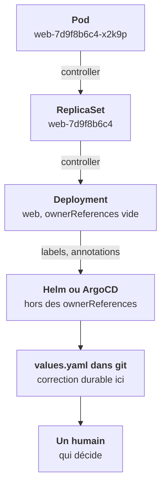

Devant un objet qui « revient », le réflexe est simple : **lis ses `ownerReferences` et remonte**. Chaque objet créé par un contrôleur porte dans ses métadonnées la trace de son propriétaire.

## Ce qu'on lit sur un pod

Le champ `metadata.ownerReferences` du pod `web-7d9f8b6c4-x2k9p`, lu avec `yq` :

```yaml
- apiVersion: apps/v1
  kind: ReplicaSet
  name: web-7d9f8b6c4
  uid: 3a1f…
  controller: true
  blockOwnerDeletion: true
```

Deux champs comptent :

- **`controller: true`** : cet objet est *géré* par ce propriétaire. Le contrôleur vérifie sans cesse qu'il existe et qu'il correspond à ce qu'il attend. C'est la marque qu'il ne faut pas agir sur l'objet, mais sur son propriétaire.
- **`blockOwnerDeletion: true`** : si on supprime le propriétaire en mode *foreground*, il attendra que cet enfant soit supprimé d'abord. Tu le retrouveras avec la cascade.

`kubectl describe` affiche la même information sur la ligne `Controlled By:`.

## Remonter, et remonter encore

Le propriétaire a souvent lui-même un propriétaire. La chaîne complète sort même du cluster :



À chaque échelon, la question est la même : *qui écrit l'état désiré de cet objet ?* Tu t'arrêtes au **premier échelon où la réponse est un fichier versionné ou une personne**. C'est là que se fait la correction durable.

Quand les `ownerReferences` sont vides, tu es au sommet de la chaîne côté Kubernetes. Pour un Deployment, c'est le cas normal : personne dans le cluster ne le possède. La suite se lit dans ses labels et annotations, c'est la leçon suivante.

<Piege>
Corriger au premier échelon trouvé, le ReplicaSet ou le Deployment, donne une correction qui tient quelques secondes ou jusqu'au prochain déploiement. Remonte jusqu'au fichier ou à la personne.
</Piege>

<Retenir>
`ownerReferences` avec `controller: true` désigne qui gère l'objet. Remonte la chaîne jusqu'au premier fichier versionné ou à la première personne : c'est là qu'on corrige.
</Retenir>
