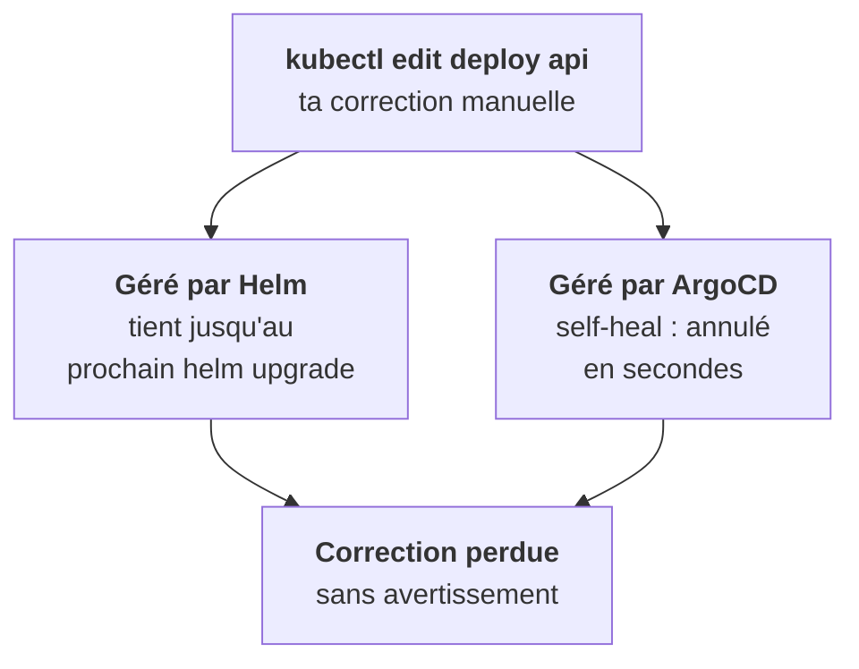
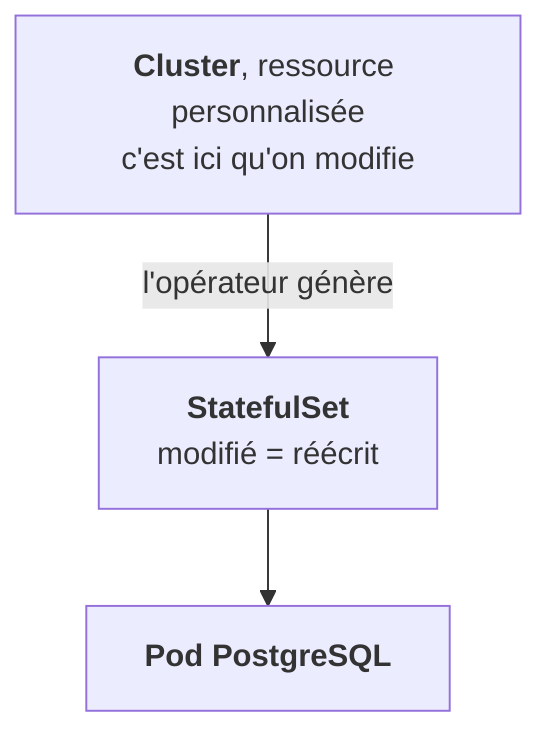

Le haut de la chaîne de propriété sort de Kubernetes. Pas d'`ownerReferences` pour le dire : il faut lire les labels et annotations. C'est là que les débutants se perdent.

## Helm : pas de boucle, mais un écrasement différé

Helm **n'a pas de contrôleur**. Aucune boucle ne surveille les objets d'une release. Si tu modifies un Deployment installé par Helm avec `kubectl edit`, ta modification tient… jusqu'au prochain `helm upgrade`, qui réapplique le manifeste rendu et l'écrase sans prévenir.

Les objets Helm se reconnaissent ainsi :

```yaml
labels:
  app.kubernetes.io/managed-by: Helm
annotations:
  meta.helm.sh/release-name: platform
  meta.helm.sh/release-namespace: platform
```

## ArgoCD et Flux : une boucle, et elle est rapide

Les outils GitOps, eux, **ont** un contrôleur. Avec le *self-heal* activé, toute dérive entre le cluster et le dépôt git est corrigée en quelques secondes ou minutes. Reconnaissables aux labels `argocd.argoproj.io/instance` ou `kustomize.toolkit.fluxcd.io/name`.



## Les opérateurs : un propriétaire de plus

Un opérateur, que tu verras à l'étape 9, est un contrôleur qui gère des objets à partir d'une ressource personnalisée (CRD). Un pod de base créé par un opérateur PostgreSQL a pour propriétaire un StatefulSet, lui-même propriété d'un objet `Cluster`.



Modifier le StatefulSet ne sert à rien : il faut modifier le `Cluster`.

## Le réflexe chez un client

**Avant de toucher à un objet, identifie l'outil qui le gère.** Une modification `kubectl` sur un objet géré par ArgoCD n'est pas seulement inutile, elle est trompeuse : tu croiras avoir corrigé quelque chose.

<Retenir>
Helm écrase au prochain upgrade, ArgoCD ou Flux en self-heal en quelques secondes, un opérateur réécrit depuis sa ressource personnalisée. Lis les labels avant d'agir.
</Retenir>
