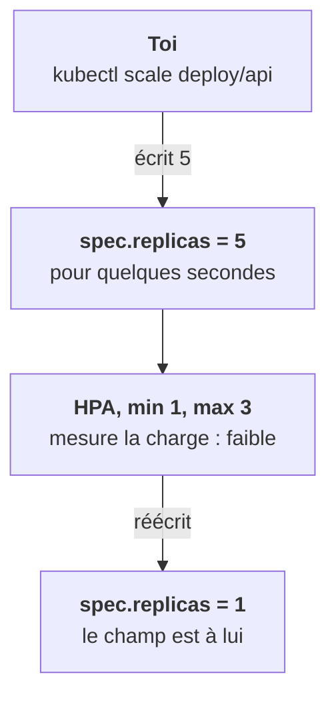
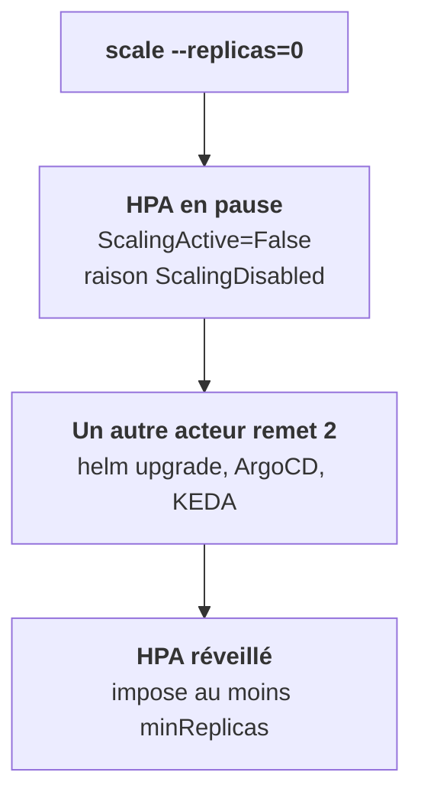

Cas plus subtil : l'objet t'appartient, mais **un champ précis** est piloté par un contrôleur. L'exemple canonique est le HorizontalPodAutoscaler, ou HPA.

## L'HPA écrit dans ton Deployment

Un HPA cible un Deployment et écrit lui-même dans `spec.replicas`, selon la charge, entre `minReplicas` et `maxReplicas`. À partir de là, ce champ ne t'appartient plus.

Tu fais `kubectl scale deploy/api --replicas=5` : l'HPA constate que la charge ne justifie pas 5 et redescend.

## Et à zéro ? Sois précis

Le cas `--replicas=0` dépend du contexte. Ne généralise pas.

- Sur un Kubernetes récent **sans autre outillage**, mettre un Deployment à 0 met l'HPA en pause. Il ne remonte pas tout seul : c'est le comportement documenté.
- Mais dès qu'un autre acteur remet une valeur non nulle, l'HPA se réveille. Ce peut être un `helm upgrade` qui réapplique `replicas: 2` du chart, un ArgoCD en self-heal ou un ScaledObject KEDA. Dans une plateforme déployée par chart parapluie, c'est le cas courant : **ton 0 a été annulé** et tu ne sais pas par qui.

## La bonne action

Ne scale pas le Deployment. Agis sur l'état désiré : désactive ou supprime l'HPA, ou passe le composant à `enabled: false` dans les values du chart. Et **note ce que tu as observé**, pas ce que tu supposes : c'est l'objet de la dernière leçon de l'étape.

Ce mécanisme de champ possédé s'appelle le *field ownership*, visible dans `metadata.managedFields`. Tu le retrouveras à l'étape 9 avec le server-side apply.

<Retenir>
Sous un HPA, `spec.replicas` ne t'appartient plus. À 0, l'HPA se met en pause, jusqu'à ce qu'un redéploiement le réveille. Pour couper un composant, agis sur l'HPA ou sur les values.
</Retenir>
