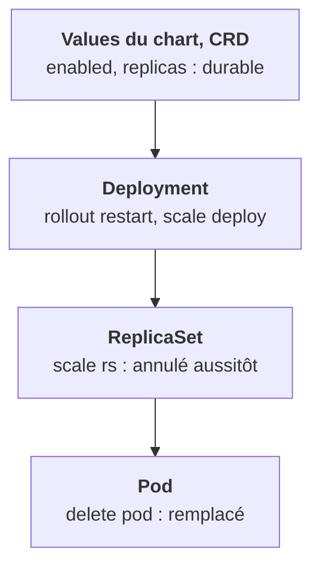

Tu sais maintenant trouver qui possède un objet. Reste à choisir le geste. À chaque niveau de la chaîne correspond une action, et une portée.

## Les réflexes à intérioriser

Pour chaque intention, l'action réflexe (mauvaise) puis l'action correcte :

- **Redémarrer une application** : pas `kubectl delete pod …`, mais `kubectl rollout restart deploy/…`. Les nouveaux pods sont créés proprement, un par un.
- **Redémarrer un pod précis**, par exemple une fuite mémoire : `kubectl delete pod` est acceptable ici. Le ReplicaSet le remplace, et tu le sais.
- **Changer le nombre de réplicas** : pas `kubectl scale rs …`, mais `kubectl scale deploy …`. Et sache que ce sera écrasé au prochain déploiement : le durable, ce sont les values du chart.
- **Couper un composant qui a un HPA** : pas `--replicas=0`. Supprime ou désactive l'HPA d'abord, ou passe `enabled: false` côté chart.
- **Changer une variable d'environnement** : pas `kubectl edit deploy …`. Modifie les values ou le manifeste versionné, puis redéploie. `edit` sert seulement pour un test dont tu sais qu'il sera perdu.
- **Changer une config d'application** : pas `kubectl edit configmap …`, même règle. Et rappelle-toi qu'un pod ne relit pas un ConfigMap injecté en variable d'env sans redémarrer.
- **Supprimer une application** : pas les pods, puis le ReplicaSet, puis… Supprime le **parent** (Deployment, release Helm, ressource personnalisée). La cascade fait le reste.
- **Supprimer un objet géré par un opérateur** : pas `kubectl delete sts …`. Supprime ou modifie la ressource personnalisée qui le pilote.

## Supprimer un pod n'est pas interdit

La ligne « redémarrer un pod précis » le montre : `kubectl delete pod` n'est pas un geste interdit. Il est dangereux **quand tu ne sais pas qui le recrée**. Une fois que tu le sais, c'est un outil comme un autre.

<Piege>
`kubectl delete pod -l app=api` pour « redémarrer » tue tous les pods d'un coup : le service est coupé le temps qu'ils reviennent. `rollout restart` fait la même chose sans coupure.
</Piege>

<Retenir>
Agis au niveau qui porte l'état désiré : rollout restart et scale sur le Deployment pour le ponctuel, values ou ressource personnalisée pour le durable, et suppression du parent pour tout retirer.
</Retenir>
