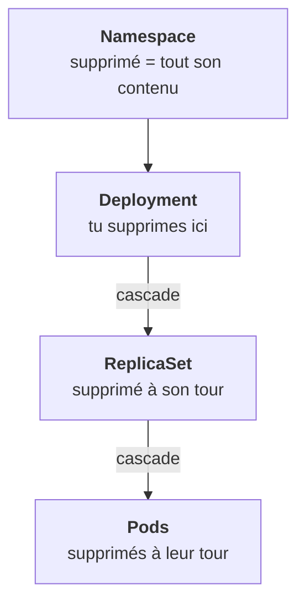
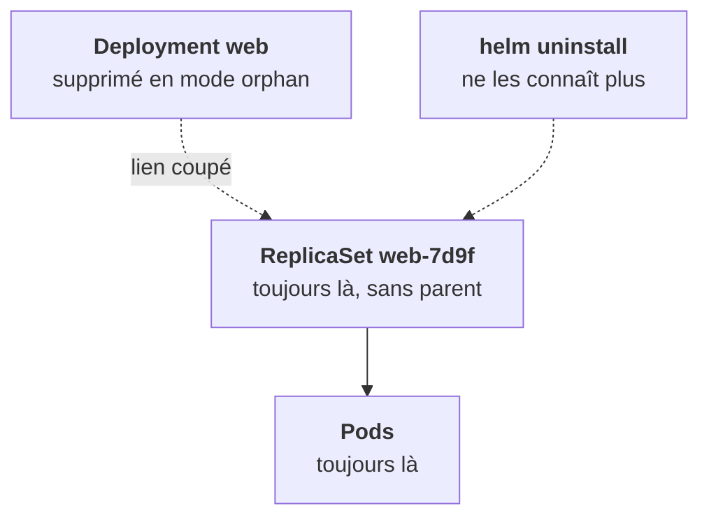

Supprimer un propriétaire supprime ses enfants : c'est la **cascade**. C'est elle qui permet de retirer une application en supprimant seulement son parent. Mais il y a trois façons de le faire.

## Les trois politiques

La politique se choisit avec l'option `--cascade` de `kubectl delete`.

| Politique | Ce qui se passe |
|---|---|
| `background` (défaut) | Le parent disparaît tout de suite, les enfants suivent |
| `foreground` | Le parent attend que tous ses enfants soient supprimés |
| `orphan` | Le parent disparaît, ses enfants **restent**, sans propriétaire |

Le `blockOwnerDeletion` vu dans les `ownerReferences` sert au mode `foreground` : c'est lui qui fait attendre le parent.

## Les orphelins

`orphan` est utile pour une migration délicate : garder les pods vivants pendant qu'on remplace le contrôleur. Il devient dangereux quand il est involontaire.

Des objets orphelins ne sont plus gérés par personne au-dessus d'eux. Plus de mise à jour, plus de rollback ; un pod orphelin supprimé ou évincé n'est plus recréé. Et ils **survivent à `helm uninstall`**, qui ne supprime que les objets de sa release.

## Le namespace, la plus destructive

Supprimer un **namespace** supprime tout ce qu'il contient. Pratique en lab, c'est l'action la plus destructive que tu puisses faire en une commande chez un client. Vérifie le contexte avant, à chaque fois.

<Piege>
Un `kubectl delete namespace` lancé sur le mauvais contexte efface une plateforme entière. Le prompt de ton terminal doit afficher le contexte, et tu le relis avant d'appuyer sur Entrée.
</Piege>

<Retenir>
Par défaut, supprimer le parent supprime ses enfants. `orphan` les laisse vivre sans propriétaire, et ils survivent à `helm uninstall`. Supprimer un namespace emporte tout : vérifie le contexte.
</Retenir>
