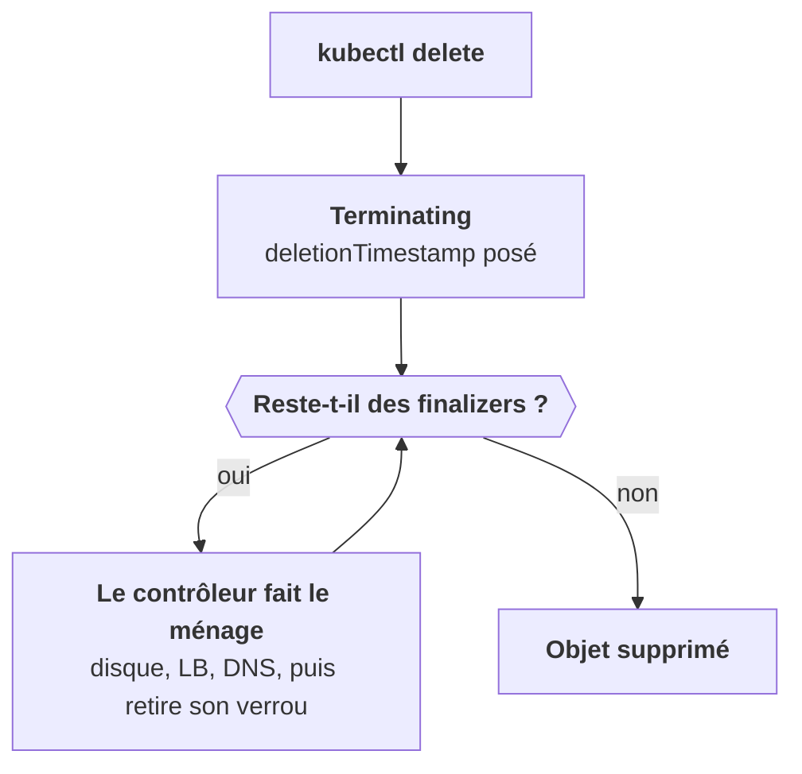

Tu supprimes un objet, et il reste affiché en `Terminating`. Indéfiniment. Ce n'est pas un bug : c'est un **finalizer** qui fait son travail, ou qui attend quelqu'un qui ne viendra plus.

## Un verrou posé par un contrôleur

Un objet peut porter dans `metadata.finalizers` une liste de verrous posés par des contrôleurs. Tant qu'un finalizer est présent, l'API server marque l'objet `Terminating` mais ne le supprime pas.

Le contrôleur concerné est censé faire son ménage, puis retirer son finalizer. Ce ménage, c'est souvent une ressource **hors du cluster** : détacher un disque, supprimer un LoadBalancer cloud, nettoyer une entrée DNS.

Un exemple que tu croiseras : `kubernetes.io/pvc-protection` sur un PVC, qui empêche de supprimer un volume encore utilisé par un pod.

## Quand ça bloque

Le cas typique : le contrôleur qui devait retirer le finalizer **n'existe plus**. Un opérateur désinstallé avant ses ressources, ou un namespace supprimé avant le contrôleur qui y vivait. La boucle du schéma n'a plus personne pour la faire tourner.

Retirer le finalizer à la main débloque l'objet, avec un `kubectl patch` qui le met à `null`.

## Pourquoi c'est un dernier recours

Forcer, c'est sauter le ménage. Ce qu'il devait nettoyer reste derrière : un disque cloud, un LoadBalancer, un enregistrement DNS qui continueront d'exister, **et d'être facturés**. Ce sont des ressources orphelines, que personne ne verra plus depuis le cluster.

Avant de forcer, demande-toi toujours : **qui a posé ce finalizer, et pourquoi ne le retire-t-il pas ?** Souvent, la vraie réparation est de remettre le contrôleur en état, ou de faire à la main le ménage qu'il aurait fait.

<Piege>
Un tuto trouvé en ligne propose de retirer tous les finalizers pour débloquer un namespace. Ça marche, et ça laisse des disques et des load balancers facturés chez le client. Identifie d'abord le contrôleur absent.
</Piege>

<Retenir>
Un finalizer est un verrou : l'objet reste en Terminating tant que son contrôleur n'a pas fait le ménage. Le retirer à la main débloque, mais laisse le ménage non fait. Dernier recours.
</Retenir>
