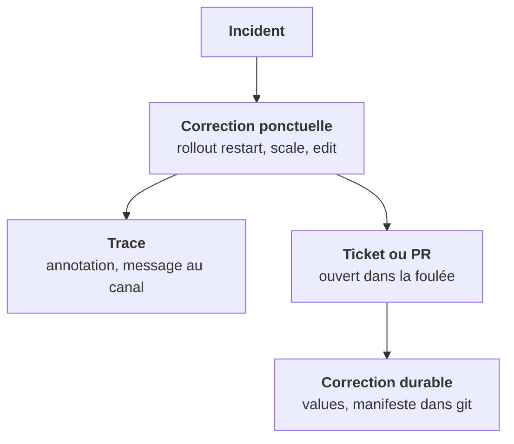

Sur un incident, il y a souvent deux temps. Les confondre, ou oublier le second, c'est la garantie de revoir le même incident.

## Les deux temps

1. **La correction ponctuelle** : `rollout restart`, `scale`, `edit`. Elle rétablit le service maintenant. Elle **sera perdue** au prochain déploiement, par construction. Ce n'est pas un défaut, c'est son rôle.
2. **La correction durable** : le changement dans la configuration versionnée. Values du chart, manifeste dans git, ressource personnalisée. Elle survit aux déploiements.

L'erreur n'est pas de faire une correction ponctuelle. L'erreur est de **ne pas dire qu'elle est ponctuelle**.

## Trois habitudes

- Après une action manuelle sur un environnement partagé, **laisse une trace** : un message dans le canal de l'environnement, ou une annotation sur l'objet, comme `ops/manual-change`.
- **Ouvre dans la foulée** le ticket ou la PR de la correction durable.
- Dans tout compte rendu, **sépare ce que tu as vérifié de ce que tu supposes**.

## Vérifié ou supposé

Reprends le cas de l'HPA. Voici deux façons de rapporter la même observation :

> ❌ « L'HPA remet le service à 1 quand on scale à 0. »

> ✅ « Vérifié sur preview-42 (K8s 1.31, chart 3.8) : scale à 0 annulé en ~30 s après un helm upgrade. Non vérifié sur un cluster sans redéploiement. »

La première est une généralisation, fausse dans certains contextes. La seconde dit **où**, **sur quelle version**, **ce qui a été observé** et **ce qui n'a pas été testé**. Un collègue peut s'appuyer dessus sans se faire piéger.

Cette discipline est la même que celle exigée en communication client, à l'étape 23. Elle commence ici, dans tes notes de lab : le lab de cette étape te demande justement ce compte rendu en trois lignes.

<Retenir>
Ponctuel : rétablit maintenant, perdu au prochain déploiement, et ça doit se dire. Durable : dans la config versionnée. Et dans tout compte rendu, le vérifié d'un côté, le supposé de l'autre.
</Retenir>
