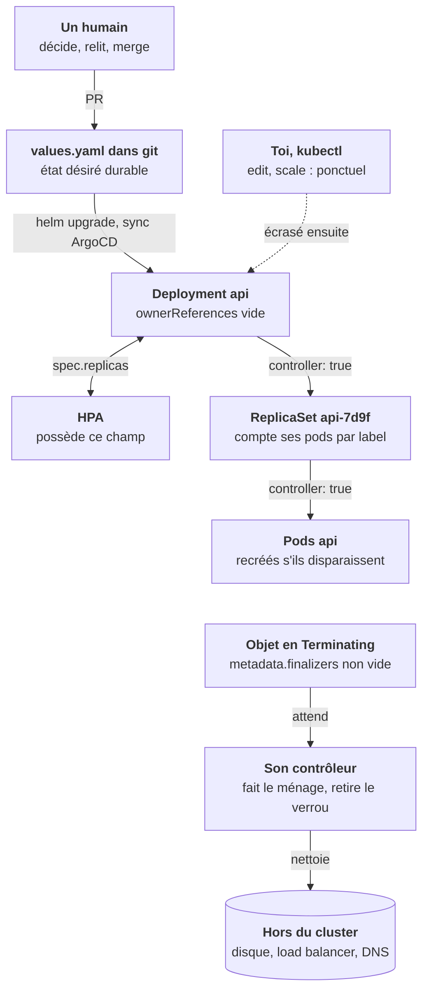
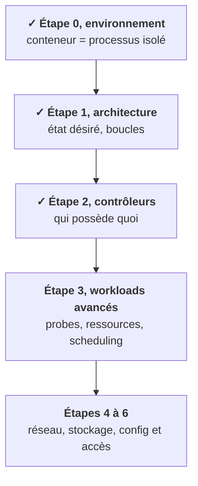

Toute l'étape tient dans une seule question : **qui écrit l'état désiré de cet objet ?** Le schéma ci-dessous rassemble la chaîne de propriété d'une API déployée par un chart, et tout ce qui peut annuler ton geste. Lance le pas à pas avec ▶, ou avance à ton rythme avec ›.

## Ce que tu sais faire maintenant

- **Reconnaître un objet qui revient** : il a un propriétaire, une boucle qui ne s'arrête pas. [Leçon 1](/l/02-controleurs/01-il-est-revenu/)
- **Remonter la chaîne** avec `ownerReferences` et `controller: true`, jusqu'à un fichier ou une personne. [Leçon 2](/l/02-controleurs/02-ownerreferences/)
- **Lire les labels** qui trahissent Helm, ArgoCD, Flux ou un opérateur, avant de toucher à quoi que ce soit. [Leçon 3](/l/02-controleurs/03-helm-argocd-operateurs/)
- **Repérer un champ possédé**, comme `spec.replicas` sous un HPA. [Leçon 4](/l/02-controleurs/04-hpa-champ-possede/)
- **Choisir le geste** : `rollout restart`, `delete pod` quand tu sais qui recrée, values pour le durable. [Leçon 5](/l/02-controleurs/05-bonne-action/)
- **Supprimer sans surprise** : cascade, orphelins, namespace, et finalizers. [Leçons 6](/l/02-controleurs/06-cascade-orphelins/) et [7](/l/02-controleurs/07-finalizers/)
- **Écrire juste** : ponctuel ou durable, vérifié ou supposé. [Leçon 8](/l/02-controleurs/08-ponctuel-durable/)

## Où tu en es dans la partie A

L'étape 1 t'a montré la boucle de réconciliation ; celle-ci t'a appris à ne plus te battre contre elle. La suite pose les objets qui font tourner une vraie plateforme : StatefulSet, Job, probes, et l'HPA que tu viens de croiser.

<Retenir>
Avant d'agir, demande qui écrit l'état désiré : `ownerReferences` dans le cluster, labels au-delà. Le geste manuel est ponctuel et se dit ; le durable va dans les fichiers versionnés. Supprimer, c'est supprimer le parent, et un finalizer ne se force qu'en connaissance de cause.
</Retenir>
