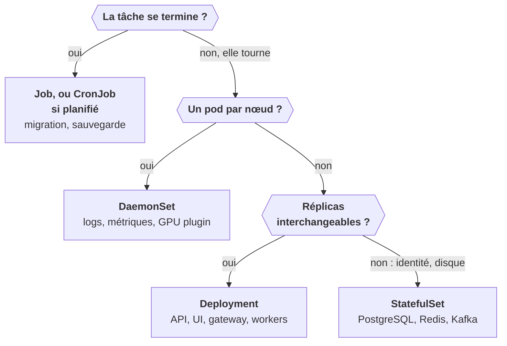
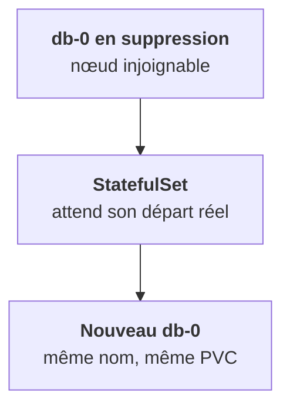

Ouvre le rendu d'un chart parapluie de plateforme LLM : des dizaines de Deployments, quelques StatefulSets, des DaemonSets, des Jobs. Chaque type est un **contrat** différent avec Kubernetes. Le bon choix se fait en une question : qu'est-ce que ce composant attend de ses pods ?

## Les trois qui tournent en continu

- **Deployment** : application *sans état*, n'importe quel réplica traite n'importe quelle requête. Pods interchangeables aux noms aléatoires, rolling update, scale libre. C'est ton API, ton UI, ta gateway, tes workers de crawl, ton routeur de modèles.
- **StatefulSet** : application *avec état*, chaque réplica a une identité et un disque à lui. Noms stables (`db-0`, `db-1`), un PVC par pod qui le suit, démarrage et arrêt ordonnés, un nom DNS par pod via un Service headless. C'est PostgreSQL, Redis, Kafka, ClickHouse, etcd, MinIO.
- **DaemonSet** : *un pod par nœud*, ou par nœud sélectionné. Pas de `replicas` : le nombre suit les nœuds, et un nœud ajouté reçoit automatiquement son pod. C'est le collecteur de logs, l'agent de métriques, le CNI, le NVIDIA device plugin, le driver CSI.

## Les deux qui se terminent

- **Job** : une tâche qui *finit*. Relancée en cas d'échec jusqu'à `backoffLimit`, parallélisable, pod en `Completed` à la fin. Migrations de schéma, import initial, hooks Helm.
- **CronJob** : un Job planifié, en syntaxe cron, avec une `concurrencyPolicy` et un historique des Jobs conservés.

## Deux comportements qui surprennent

Un StatefulSet **ne remplace pas** un pod tombé aussi vite qu'un Deployment. C'est sa raison d'être : protéger l'identité et le disque.

Un Job qui a échoué `backoffLimit` fois reste en `Failed` **avec ses pods** : c'est là que tu lis ses logs. À l'inverse, supprimer le pod d'un Job `Completed` ne relance rien.

<Retenir>
Interchangeable : Deployment. Identité et disque : StatefulSet. Un par nœud : DaemonSet. Ça se termine : Job, ou CronJob si c'est planifié.
</Retenir>
