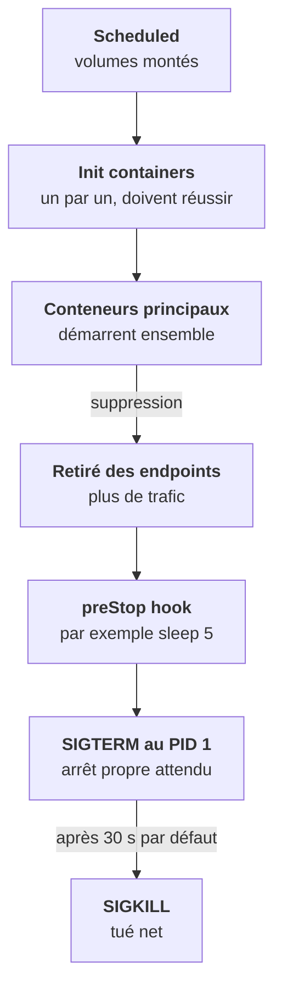

Un pod qui met cinq minutes à démarrer n'est pas forcément cassé. Pour le savoir, il faut connaître la séquence complète, et où tu peux te brancher à chaque étape.



## Les init containers

Ils tournent **avant** les conteneurs principaux, **un par un**, et doivent **réussir** (code de sortie 0). Si l'un échoue, il est relancé ; les principaux ne démarrent jamais tant que tous ne sont pas passés.

Usages typiques : attendre qu'une base réponde, exécuter une migration, télécharger un modèle, générer une config.

```yaml
initContainers:
  - name: wait-db
    image: busybox:1.36
    command: ['sh', '-c', 'until nc -z db 5432; do echo waiting; sleep 2; done']
```

Dans une plateforme LLM, c'est **la cause n° 1 de « ça met des minutes à démarrer »**. Une migration de cinq minutes bloque toute l'application, et c'est normal. Distingue *long* de *cassé* : `Init:1/2` sans erreur dans les Events, c'est long ; `Init:CrashLoopBackOff`, c'est cassé. Dans les deux cas, le réflexe est `kubectl logs <pod> -c <nom-de-l-init>`.

## Les sidecars

Un sidecar est un conteneur auxiliaire qui vit à côté du principal : proxy, collecteur de logs, agent. Depuis Kubernetes 1.29, la façon propre est un **init container avec `restartPolicy: Always`** : il démarre avant les principaux, reste actif, et s'arrête après eux.

Avant, c'était un second conteneur dans `containers`, sans ordre garanti. Symptôme typique : un Job qui ne se termine jamais, parce que son sidecar tourne encore.

## L'arrêt propre

À la suppression, le pod sort d'abord du Service, puis reçoit `SIGTERM`. Deux conséquences :

- Une application qui ignore `SIGTERM`, ou dont le PID 1 est un `sh -c` qui ne transmet pas les signaux (étape 0), met 30 s à s'arrêter à chaque déploiement et coupe des requêtes en cours.
- Un hook `preStop` (`sleep 5`) laisse au retrait des endpoints le temps de se propager avant l'arrêt du processus. Ça évite des 502 pendant les rolling updates.

<Retenir>
Init containers un par un, puis principaux ensemble. À l'arrêt : retrait du Service, `preStop`, `SIGTERM`, et `SIGKILL` après le délai de grâce. Un pod en `Init` sans erreur est long, pas cassé : lis les logs de l'init.
</Retenir>
