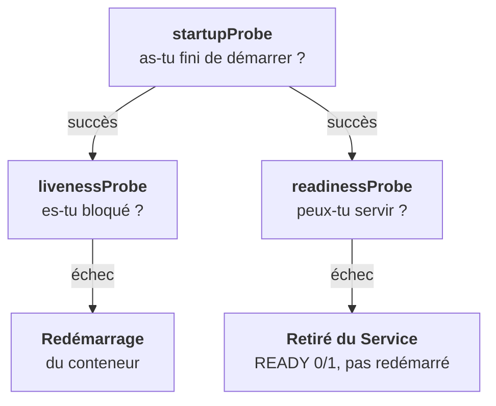

C'est le point le plus mal compris de Kubernetes, et le plus important pour la stabilité d'une plateforme. Chaque probe pose **une question différente**, et son échec a une conséquence différente.



## Une question par probe

| Probe | Question | Erreur classique |
|---|---|---|
| **startup** | « As-tu fini de démarrer ? » | L'oublier sur une app lente : la liveness la tue avant la fin, CrashLoopBackOff perpétuel |
| **liveness** | « Es-tu bloqué ? » | La brancher sur la base : une base lente redémarre toute la plateforme en boucle |
| **readiness** | « Peux-tu servir maintenant ? » | L'omettre : du trafic arrive sur un pod pas prêt, 502 et 503 pendant les déploiements |

La startup ne redémarre qu'après `failureThreshold × periodSeconds` sans succès. La règle d'or : **liveness = mon processus est-il bloqué, jamais de dépendance externe. Readiness = suis-je capable de servir, dépendances comprises. Startup = laissez-moi le temps.**

```yaml
startupProbe:
  httpGet: { path: /healthz, port: 8000 }
  failureThreshold: 30
  periodSeconds: 5
livenessProbe:
  httpGet: { path: /healthz, port: 8000 }
  periodSeconds: 10
readinessProbe:
  httpGet: { path: /ready, port: 8000 }
  periodSeconds: 5
```

Trois façons de tester : `httpGet` (code 2xx ou 3xx), `tcpSocket` (port ouvert), `exec` (commande qui sort en 0). Les réglages : `initialDelaySeconds`, `periodSeconds`, `timeoutSeconds`, `failureThreshold`, `successThreshold`.

Cas LLM : un serveur d'inférence charge un modèle de plusieurs dizaines de Go. Sans startup probe généreuse (`failureThreshold: 60`, `periodSeconds: 10`, soit 10 minutes), il est tué avant d'avoir fini. Tu y reviendras à l'étape 15.

## Ce que veut dire CrashLoopBackOff

`restartPolicy` vaut `Always` par défaut (Deployments), `OnFailure` ou `Never` pour les Jobs. Après chaque crash, le délai avant le redémarrage suivant **double** : 10 s, 20 s, 40 s… jusqu'à 5 minutes. C'est le « BackOff » de `CrashLoopBackOff`. Le compteur se remet à zéro après 10 minutes sans crash.

<Piege>
`READY 0/1` avec `RESTARTS` à 0 n'est pas un crash : c'est la readiness. Ne cherche pas dans `--previous`, il n'y a pas de conteneur précédent. Regarde la probe et `kubectl get endpoints`.
</Piege>

<Retenir>
Startup : laisse démarrer. Liveness : redémarre si bloqué, sans jamais tester une dépendance. Readiness : retire du Service si pas prêt, sans redémarrer.
</Retenir>
