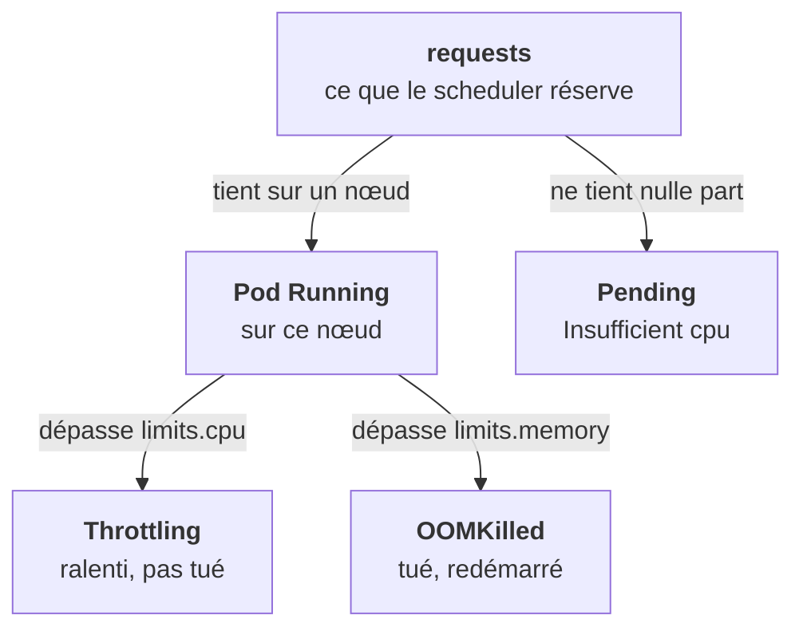

Les `resources` d'un conteneur cachent deux mécanismes que tout le monde confond : la **réservation** et le **plafond**. Ils servent à des moments différents, et leurs symptômes n'ont rien à voir.

```yaml
resources:
  requests:
    cpu: 500m        # 0,5 cœur : sert au scheduling et au partage garanti
    memory: 512Mi
  limits:
    cpu: "2"         # au-delà : ralenti (throttling)
    memory: 1Gi      # au-delà : TUÉ (OOMKilled)
```



## Requests et limits

**Requests** : ce que le scheduler réserve sur le nœud. Un pod dont les requests ne tiennent sur aucun nœud reste `Pending`. C'est aussi sa part garantie quand le nœud est sous tension.

**Limits** : le plafond appliqué par le cgroup (étape 0). Dépasser la CPU ralentit ; dépasser la mémoire tue, et le pod affiche `OOMKilled` dans `Last State`.

## Les classes de QoS

Kubernetes déduit une classe de chaque pod. Elle décide qui part en premier quand un nœud manque de mémoire.

| Classe | Condition | Sous pression mémoire |
|---|---|---|
| `Guaranteed` | requests = limits, CPU et mémoire, tous conteneurs | Expulsé en dernier |
| `Burstable` | au moins une request, pas Guaranteed | Après les BestEffort |
| `BestEffort` | ni requests ni limits | Expulsé en premier |

Des pods `BestEffort` sur un cluster client sont un signal d'alarme : premières victimes d'une éviction, et ils faussent le scheduling puisqu'ils ne réservent rien. Les bases d'une plateforme sont typiquement `Guaranteed`.

**Éviction** : quand le kubelet voit le nœud à court de mémoire ou de disque, il expulse des pods (statut `Evicted`) dans cet ordre. Le pod n'est pas redémarré sur place : son contrôleur en recrée un ailleurs. Des `Evicted` qui s'accumulent signalent un nœud sous-dimensionné.

<Piege>
`kubectl top pod` montre la consommation réelle ; `describe node` montre les requests allouées. Un nœud peut être plein pour le scheduler tout en dormant, et l'inverse. Regarde toujours les deux.
</Piege>

Dernier cas : `nvidia.com/gpu: 1` est une ressource étendue. Elle se met en `limits` (la request suit), et un GPU ne se partage pas par défaut. Étape 15.

<Retenir>
La request place et garantit ; la limit plafonne. CPU dépassée : ralentie. Mémoire dépassée : `OOMKilled`. Sous pression, BestEffort part en premier, Guaranteed en dernier.
</Retenir>
