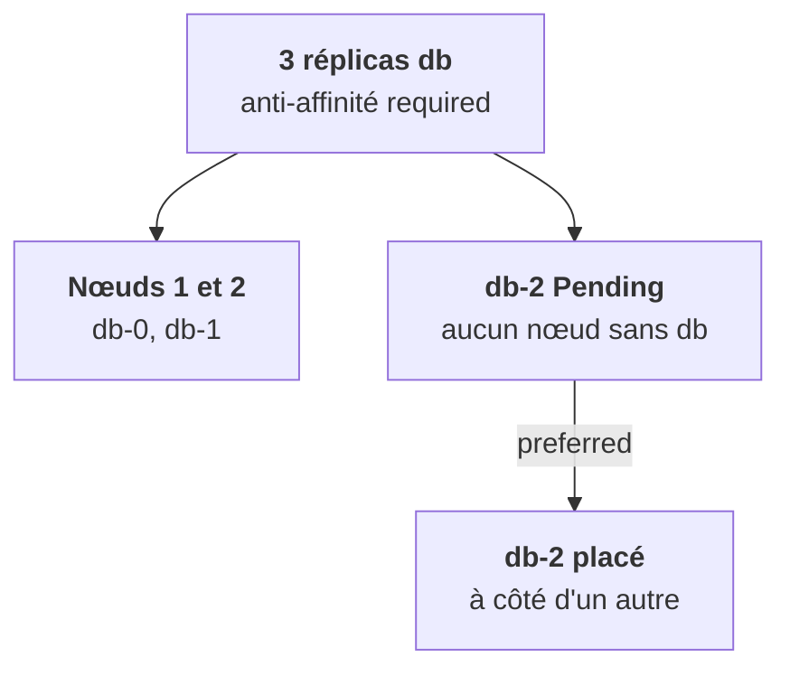

Le scheduler **filtre** les nœuds possibles, puis **note** ceux qui restent. Une partie de tes leviers agit côté pod : il dit où il veut aller, ou près de qui. Tu les croiseras dans tous les charts, surtout pour les GPU et la haute disponibilité.

## nodeSelector, le plus simple

Le pod ne va que sur les nœuds portant ces labels. Rien d'autre.

```yaml
nodeSelector:
  nvidia.com/gpu.present: "true"
```

## Les affinités, plus expressives

Chaque règle est `required` (contrainte dure : sinon `Pending`) ou `preferred` (souhait pondéré, le scheduler fait au mieux).

- **nodeAffinity** : comme `nodeSelector`, avec des opérateurs (`In`, `NotIn`, `Exists`, `Gt`…).
- **podAffinity** : « place-moi près des pods qui ont tel label ». Par exemple le cache près de l'API.
- **podAntiAffinity** : « ne me place **pas** avec les pods qui ont tel label ». C'est ce qui met 3 réplicas d'une base sur 3 nœuds différents, indispensable pour la haute disponibilité.

```yaml
affinity:
  podAntiAffinity:
    requiredDuringSchedulingIgnoredDuringExecution:
      - labelSelector:
          matchLabels: { app: db }
        topologyKey: kubernetes.io/hostname   # « un par nœud »
```

Le nom à rallonge dit exactement ce qu'il fait : contrainte appliquée **au placement**, pas réévaluée ensuite. `topologyKey` fixe le domaine : `kubernetes.io/hostname` pour « un par nœud », `topology.kubernetes.io/zone` pour « un par zone ».

## Le piège classique chez un client



Le message `FailedScheduling` le dit en toutes lettres, mais il faut aller le lire dans `describe`.

## Topology spread : répartir

Pour beaucoup de réplicas, l'anti-affinité « un par domaine » ne tient pas. Les `topologySpreadConstraints` répartissent uniformément sur un domaine (zones, nœuds) avec un **écart maximal toléré**, `maxSkew`. Avec `whenUnsatisfiable: DoNotSchedule`, un pod qui creuserait l'écart reste `Pending`.

<Retenir>
`nodeSelector` et `nodeAffinity` visent des nœuds, `podAffinity` et `podAntiAffinity` des voisins, le topology spread une répartition. `required` sans solution, c'est `Pending` pour toujours.
</Retenir>
