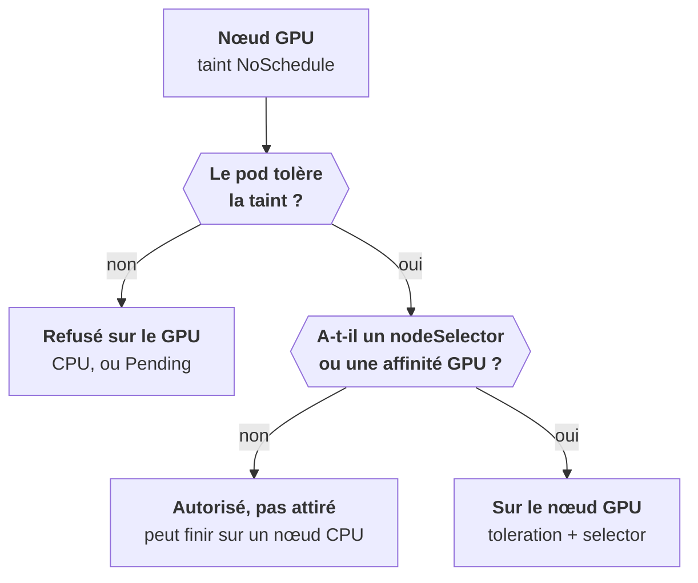

L'affinité, c'est le pod qui choisit. Ici c'est l'inverse : **le nœud repousse**. Un nœud *tainted* n'accepte que les pods qui *tolèrent* sa taint. Usage canonique : réserver les nœuds GPU, chers, aux workloads GPU.



## Taint et toleration

La taint se pose sur le nœud, la toleration dans le pod :

```yaml
tolerations:
  - key: nvidia.com/gpu
    operator: Exists
    effect: NoSchedule
```

Trois effets : `NoSchedule` (pas de nouveau pod), `PreferNoSchedule` (éviter si possible), `NoExecute` (expulse aussi les pods déjà présents).

Une **toleration ne force pas** le placement, elle l'autorise. Pour forcer, il faut toleration **et** `nodeSelector` ou affinité.

Tu en croises sans les avoir posées : les nœuds du control plane sont tainted par défaut. Et Kubernetes pose des taints automatiques (`node.kubernetes.io/not-ready`, `…/unreachable`) qui expulsent les pods d'un nœud en panne après `tolerationSeconds`, 300 s par défaut.

## Priorité et préemption

Une `PriorityClass` donne un rang au pod. Quand le cluster est plein, un pod de haute priorité peut **expulser** des pods de priorité inférieure pour prendre leur place. Utile pour que la gateway et la base passent avant les workers. Les composants système utilisent `system-cluster-critical`.

## Lire un FailedScheduling

Les trois motifs de la partie, côte à côte :

| Message | Cause | Réflexe |
|---|---|---|
| `Insufficient cpu` / `memory` | requests trop grosses pour les nœuds | revoir les requests, ou ajouter des nœuds |
| `untolerated taint` | le nœud repousse le pod | toleration, ou retrait de la taint |
| `didn't match pod anti-affinity rules` | règle impossible sur ce cluster | `preferred`, ou plus de nœuds |

<Retenir>
La taint repousse, la toleration autorise, le selector force : pour un nœud GPU, il faut les deux derniers. Un `FailedScheduling` dit toujours lequel des trois coince : ressources, taint ou affinité.
</Retenir>
