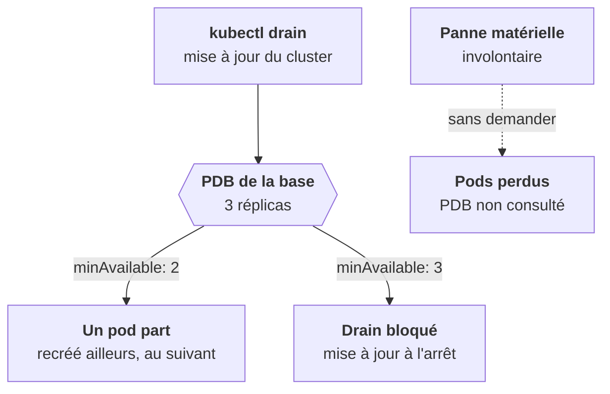

Un cluster client bouge tout le temps : tes déploiements, ses mises à jour de nœuds, ses autoscalers. Trois mécanismes décident si la plateforme reste debout pendant ces changements.

## Les stratégies de mise à jour

Un Deployment a une `strategy` :

- `RollingUpdate` (défaut), réglée par `maxSurge` (pods **en plus** autorisés pendant la transition, 25 % par défaut) et `maxUnavailable` (pods **en moins** tolérés, 25 % par défaut). `maxSurge: 1, maxUnavailable: 0` : jamais moins de capacité que prévu, un pod de plus pendant le déploiement.
- `Recreate` : tout couper, puis tout relancer. Pour ce qui ne supporte pas deux versions en parallèle, ou un volume `ReadWriteOnce` qu'un seul pod peut monter (étape 5).

Un StatefulSet met à jour **dans l'ordre inverse** (`db-2` d'abord, `db-0` en dernier) et attend que chaque pod soit `Ready` avant le suivant. `partition` limite la mise à jour aux index supérieurs ou égaux à N : un canari.

## Le PodDisruptionBudget

Un PDB dit combien de pods d'un groupe doivent rester disponibles pendant une **perturbation volontaire** : `kubectl drain` pour une mise à jour de cluster, autoscaler qui retire un nœud.

```yaml
apiVersion: policy/v1
kind: PodDisruptionBudget
metadata: { name: db }
spec:
  minAvailable: 2          # ou maxUnavailable: 1
  selector:
    matchLabels: { app: db }
```



Sans PDB, une mise à jour de cluster peut vider d'un coup un nœud qui porte les 3 réplicas de la base. Avec un PDB trop strict, le nœud ne se vide **jamais** : c'est un piège tout aussi réel.

## L'autoscaling

- **HPA** (étape 2) : ajuste `replicas` selon CPU, mémoire ou métriques custom. Il lui faut des `requests` et metrics-server.
- **VPA** : ajuste les `requests` selon la consommation observée. En mode `Off`, il recommande seulement : utile pour dimensionner une plateforme sur un cluster client sans deviner. Ne combine pas HPA et VPA sur la même métrique.
- **Cluster Autoscaler, Karpenter** : ajoutent des **nœuds** quand des pods restent `Pending` faute de ressources. D'où la vague de `Pending` qui se résorbe en quelques minutes au début d'un déploiement sur GKE.

<Retenir>
`maxSurge` et `maxUnavailable` règlent la capacité pendant un rollout. Un PDB protège des perturbations volontaires, pas des pannes, et trop strict il bloque la mise à jour du cluster.
</Retenir>
