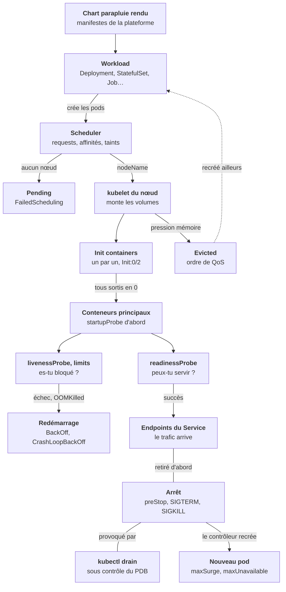
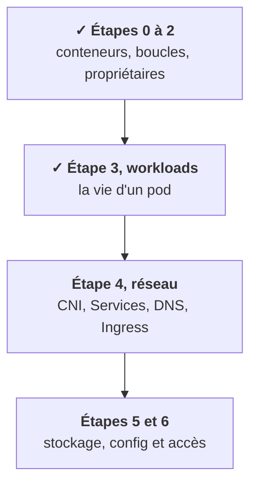

Toute l'étape suit un seul fil : **la vie d'un pod**. Le workload décide comment il est recréé, le scheduler où il atterrit, le kubelet comment il démarre, vit et meurt. Chaque statut bizarre de `kubectl get pods` correspond à une case de ce schéma. Lance le pas à pas avec ▶, ou avance à ton rythme avec ›.

## Ce que tu sais faire maintenant

- **Choisir le workload** en une question : interchangeable, identité et disque, un par nœud, ou tâche qui se termine. [Leçon 1](/l/03-workloads/01-choisir-workload/)
- **Lire un pod en Init** et savoir ce qui se passe à son arrêt. [Leçon 2](/l/03-workloads/02-demarrage-arret/)
- **Régler les trois probes**, sans jamais brancher la liveness sur une dépendance. [Leçon 3](/l/03-workloads/03-trois-probes/)
- **Dimensionner** requests et limits, et reconnaître `Insufficient cpu`, `OOMKilled` et `Evicted`. [Leçon 4](/l/03-workloads/04-requests-limits-qos/)
- **Lire un placement** : selector, affinités, anti-affinité, topology spread. [Leçon 5](/l/03-workloads/05-placement-affinites/)
- **Réserver des nœuds GPU** et dire d'où vient un `FailedScheduling`. [Leçon 6](/l/03-workloads/06-taints-priorite/)
- **Traverser les changements** : rolling update, PDB, autoscalers. [Leçon 7](/l/03-workloads/07-rolling-pdb-autoscaling/)

## Où tu en es dans la partie A

Tu sais maintenant pourquoi un pod est là, ou pourquoi il n'y est pas. L'étape 4 suit le trafic : comment la readiness et les endpoints que tu viens de voir deviennent une adresse joignable, du Service jusqu'à l'Ingress.

<Retenir>
Le workload fixe comment un pod est recréé, le scheduler où il va, les probes s'il reçoit du trafic ou redémarre. Requests pour placer, limits pour plafonner. Un PDB protège des gestes volontaires, à condition de laisser passer au moins un pod.
</Retenir>
