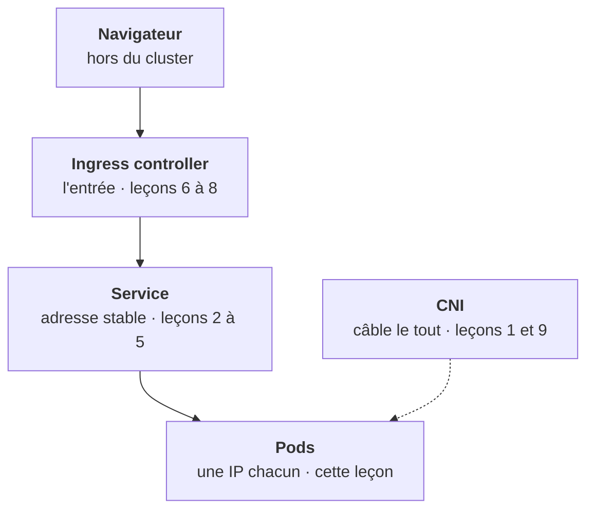
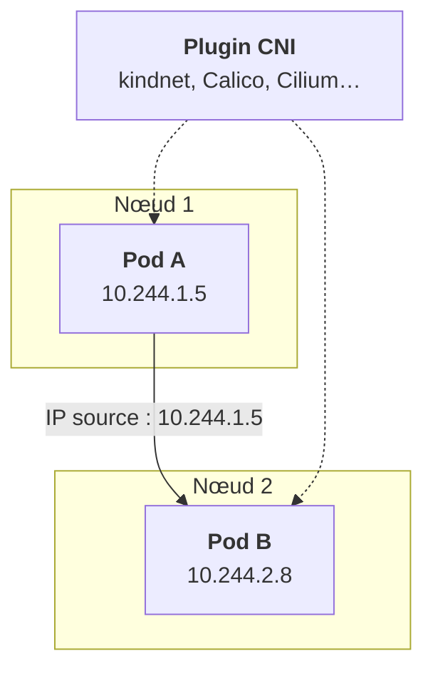

<Idee>
Kubernetes ne fabrique pas le réseau. Il exige trois règles simples (une IP par pod, tout pod joint tout pod, sans traduction d'adresse) et laisse un plugin, le **CNI**, les réaliser.
</Idee>

<Analogie>
Une entreprise où chaque salarié a **sa ligne directe**. N'importe qui appelle n'importe qui, et le numéro qui s'affiche est le vrai. L'**installateur télécom** qui a câblé l'immeuble, c'est le CNI : chaque entreprise a le sien. On garde cette image de téléphonie pendant toute l'étape.
</Analogie>

## La carte de l'étape

« La console ne répond pas », « l'API renvoie 502 » : chez un client, presque tout incident a l'air réseau. Voici le trajet d'une requête. Chaque leçon zoome sur une boîte.

## Trois règles, un plugin

1. Chaque pod a sa propre IP, unique dans le cluster.
2. Tout pod peut joindre tout pod, sur n'importe quel nœud, **sans NAT** : le destinataire voit l'IP réelle de l'appelant.
3. Les agents d'un nœud (kubelet) peuvent joindre tous les pods du nœud.

C'est un réseau **plat** : pas de ports à mapper comme avec `docker run -p`, pas de traduction d'adresses entre pods.

## Deux plages, propres à chaque cluster

Les IPs des pods viennent du **pod CIDR** (par exemple `10.244.0.0/16`), celles des Services du **service CIDR** (par exemple `10.96.0.0/12`). Ces plages sont fixées à la création du cluster et **diffèrent chez chaque client**. Un chart qui code une IP en dur est cassé par construction.

## Le CNI, ce qui varie le plus

| CNI | Où tu le verras | NetworkPolicy |
|---|---|---|
| kindnet | kind, ton lab | ✘ ignorées |
| Calico | on-prem, RKE2, kubeadm | ✔ complètes |
| Cilium | GKE Dataplane V2, clusters récents | ✔ jusqu'au L7 (eBPF, remplace kube-proxy) |
| Flannel | k3s par défaut | ✘ pas seul |
| OVN-Kubernetes | OpenShift | ✔ plus ses propres objets réseau |

<Terrain>
Une NetworkPolicy de ton chart sera **appliquée ou ignorée** selon le CNI du client. « Quel CNI tourne ici ? » est la première question réseau à poser.
</Terrain>

<Piege>
Dire « les composants sont isolés » parce que le chart livre des NetworkPolicy. Sans CNI qui les applique, elles ne font rien.
</Piege>

<Retenir>
Une IP par pod, tout pod joint tout pod sans NAT. Le CNI réalise ce modèle et varie d'un client à l'autre : c'est lui qui décide si tes NetworkPolicy existent vraiment.
</Retenir>
