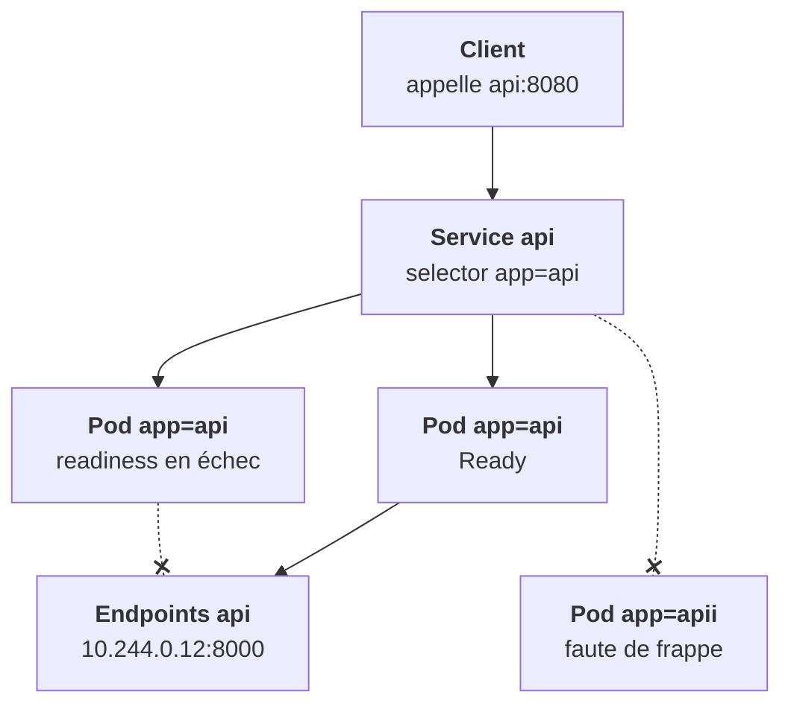

Un pod meurt, son IP disparaît. Le **Service** donne un nom et une adresse stables à un groupe de pods. Mais il ne fait rien lui-même : sur chaque nœud, kube-proxy (ou Cilium) installe des règles qui redirigent l'IP du Service vers les IPs des pods ciblés.

## port et targetPort

```yaml
apiVersion: v1
kind: Service
metadata:
  name: api
spec:
  type: ClusterIP          # le défaut
  selector:
    app: api
  ports:
    - name: http
      port: 8080           # le port du Service
      targetPort: 8000     # le port DU CONTENEUR (nombre ou nom)
```

Les clients appellent `api:8080`, le trafic arrive au conteneur sur `8000`. `targetPort` peut aussi être le **nom** d'un port déclaré dans le pod.

## Les endpoints : qui est vraiment derrière

Le Service ne cible que les pods **sélectionnés par label ET `Ready`**. La liste effective vit dans un objet séparé, l'Endpoints (ou ses EndpointSlices). `kubectl get endpoints api` est **la commande n° 1** du diagnostic réseau : elle dit si le Service a quelqu'un à qui parler.



## Trois causes, pas une de plus

Un Service avec `ENDPOINTS <none>` a exactement trois causes possibles :

1. **Le selector ne correspond à aucun label** de pod : faute de frappe, chart mal rendu.
2. **Aucun pod n'est `Ready`** : readiness en échec, comme à l'étape 3.
3. **Le Service n'a pas de selector** : c'est un Service « manuel », dont on gère les endpoints à la main, cas des services externes.

Et une chose que les endpoints ne vérifient pas : le **port**. Un `targetPort` faux laisse des endpoints bien remplis, mais la connexion échoue. Symptôme différent, cause différente.

<Retenir>
Un Service vise les pods sélectionnés et Ready ; `kubectl get endpoints` montre lesquels. `<none>` : selector, readiness, ou pas de selector. Endpoints présents mais connexion en échec : regarde le targetPort.
</Retenir>
