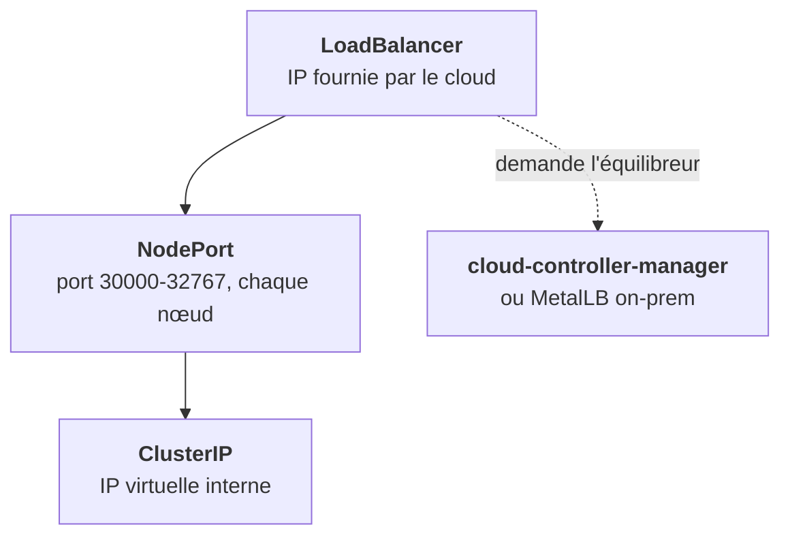

Le champ `type` d'un Service décide **d'où** on peut le joindre. Les trois premiers types s'emboîtent : chacun ajoute une couche au précédent.

## Les trois qui s'emboîtent

- **ClusterIP** : l'IP virtuelle interne. Le défaut, pour toute communication entre composants.
- **NodePort** : ClusterIP **plus** un port ouvert sur **chaque** nœud, joignable via `IP-de-n'importe-quel-nœud:port`. Rare en prod, utile en lab ou on-prem sans équilibreur, et base du LoadBalancer.
- **LoadBalancer** : NodePort **plus** un équilibreur externe que le cloud-controller-manager demande au cloud. C'est l'entrée du cluster sur GKE, AWS ou Azure.

## Les deux à part

| Type | Ce qu'il fait | Usage |
|---|---|---|
| **Headless** (`clusterIP: None`) | Pas d'IP virtuelle : le DNS renvoie les IPs des pods | StatefulSets, clients qui équilibrent eux-mêmes (Kafka, gRPC) |
| **ExternalName** | Un alias DNS (CNAME) vers un nom externe | Pointer `postgres` vers une base managée sans toucher la config |

Les deux ne sont joignables que de l'intérieur du cluster.

## Le classique on-prem

Le chart demande `type: LoadBalancer`, le cluster n'a personne pour le fournir. `EXTERNAL-IP` reste à `<pending>`, sans autre erreur. Trois sorties :

1. installer **MetalLB** ou un équivalent ;
2. passer en **NodePort** et laisser le client placer son propre équilibreur devant ;
3. prévoir une **valeur de chart** qui bascule le type selon l'environnement.

<Piege>
Attendre qu'un `<pending>` se résolve sur un cluster on-prem. Il ne bougera jamais : vérifie d'abord qu'il existe quelqu'un pour fournir l'IP.
</Piege>

<Retenir>
ClusterIP pour l'interne, NodePort ajoute un port sur chaque nœud, LoadBalancer ajoute un équilibreur fourni par le cloud ou par MetalLB. Headless donne les IPs des pods, ExternalName un alias vers l'extérieur.
</Retenir>
