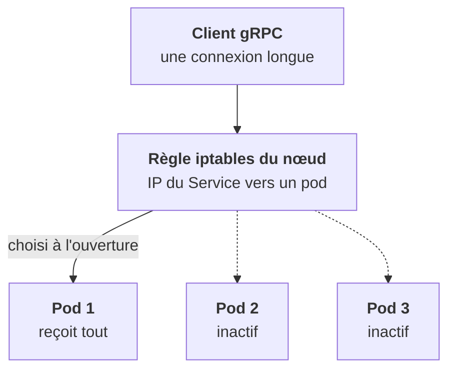
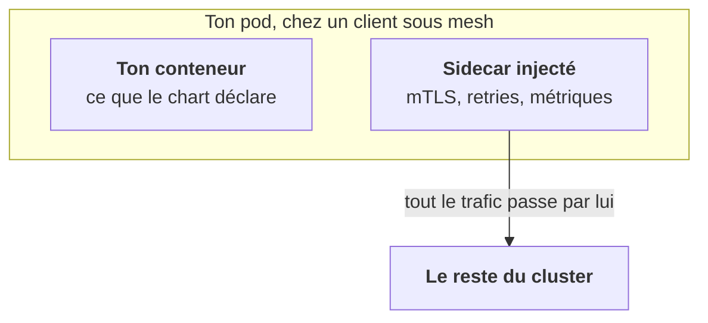

<Idee>
kube-proxy ne lit pas tes requêtes. Il choisit un pod **une seule fois, à l'ouverture de la connexion**, puis tout ce qui passe par cette connexion va au même pod. Tout ce qui est plus fin (réessayer, chiffrer) est le travail d'un autre outil.
</Idee>

<Analogie>
Au standard, l'aiguillage se fait **au décroché**. Une fois en ligne avec un agent, tu restes avec lui jusqu'à ce que tu raccroches, même si tu poses cent questions. Et si ça coupe, le standard ne rappelle pas. Le **mesh**, c'est un assistant assis à côté de chaque salarié : il chiffre, rappelle et note tout.
</Analogie>

## Ce que kube-proxy fait vraiment

Le nom trompe : il ne « proxifie » rien au sens applicatif. Sur chaque nœud, il écrit des règles **iptables** (ou **IPVS**) qui réécrivent l'adresse de destination des paquets : l'IP du Service devient l'IP d'un pod des endpoints. Avec Cilium, le noyau fait ce travail en eBPF et kube-proxy disparaît.

Deux conséquences :

- **L'équilibrage est par connexion, pas par requête.** Une connexion HTTP keep-alive ou gRPC reste collée au même pod, avec toutes ses requêtes.
- **Pas de retry, pas de circuit breaker.** kube-proxy ne voit que des paquets. Pour ça, il faut un proxy applicatif : ingress, gateway ou mesh.

<Terrain>
Surprise fréquente sur les services d'inférence : trois pods, un seul qui chauffe. Avant de chercher un bug dans ton service, pense à l'équilibrage par connexion.
</Terrain>

## Le service mesh, en une minute

Istio, Linkerd, Cilium mesh : un proxy à côté de chaque pod (ou dans le noyau pour Cilium) prend en charge ce que kube-proxy ne fait pas.

<Compare>
<Cas titre="kube-proxy">

- voit des paquets
- un pod par connexion
- ✘ retries
- ✘ mTLS
- déjà là, rien à gérer

</Cas>
<Cas titre="Service mesh">

- voit des requêtes
- routage fin
- ✔ retries, timeouts, circuit breaking
- ✔ mTLS, métriques et traces
- une complexité réelle

</Cas>
</Compare>

Tu le croiseras chez des clients qui l'imposent, souvent avec Istio ou OpenShift Service Mesh.

<Piege>
Un sidecar injecté dans tes pods change le réseau sans que ton chart ait bougé : un Job qui ne finit plus, un port non déclaré qui ne passe plus. Regarde la liste des conteneurs du pod.
</Piege>

<Retenir>
kube-proxy réécrit des adresses à l'ouverture d'une connexion : équilibrage par connexion, sans retry. Le mesh ajoute un proxy par pod qui fait le travail applicatif, au prix d'une vraie complexité.
</Retenir>
