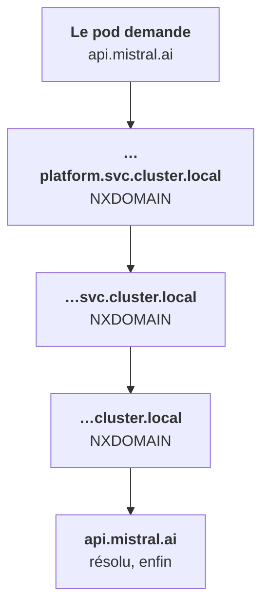

Dans le cluster, on ne s'adresse pas par IP mais par nom. **CoreDNS**, qui tourne dans `kube-system`, répond pour la zone `cluster.local` et donne un nom à chaque Service.

## La forme complète

```
<service>.<namespace>.svc.cluster.local
api.platform.svc.cluster.local
```

Les pods d'un StatefulSet derrière un Service headless ont chacun leur nom : `db-0.db.platform.svc.cluster.local`.

## Les formes courtes, grâce au resolv.conf

Kubernetes injecte dans chaque pod des domaines de recherche :

```
search platform.svc.cluster.local svc.cluster.local cluster.local
nameserver 10.96.0.10
options ndots:5
```

- `api` : résolu si `api` est dans le **même** namespace ;
- `api.platform` : depuis n'importe quel namespace ;
- `api.platform.svc.cluster.local` : toujours. C'est la forme à mettre dans une configuration, sans ambiguïté.

## Le piège ndots:5

Avec `ndots:5`, tout nom de **moins de 5 points** est d'abord essayé avec chaque domaine de recherche, avant d'être résolu tel quel. `api.mistral.ai` n'a que 2 points.



Résultat : des latences, et des logs CoreDNS pleins de NXDOMAIN. Deux remèdes :

- un **point final** dans la config (`api.mistral.ai.`), qui rend le nom absolu ;
- `dnsConfig.options` avec `ndots` à `"2"` sur les pods qui appellent beaucoup l'extérieur.

## Diagnostiquer quand l'image est vide

Une image `distroless` ou `scratch` n'a ni `nslookup` ni `sh`. Lance un pod outil à côté, `nicolaka/netshoot` : il a `nslookup`, `dig`, `curl`, `tcpdump`, `nc`, `traceroute`.

<Retenir>
`service.namespace.svc.cluster.local` résout toujours : c'est la forme des configs. Avec `ndots:5`, un nom externe court passe d'abord par tous les domaines du cluster : point final ou `ndots` plus bas.
</Retenir>
