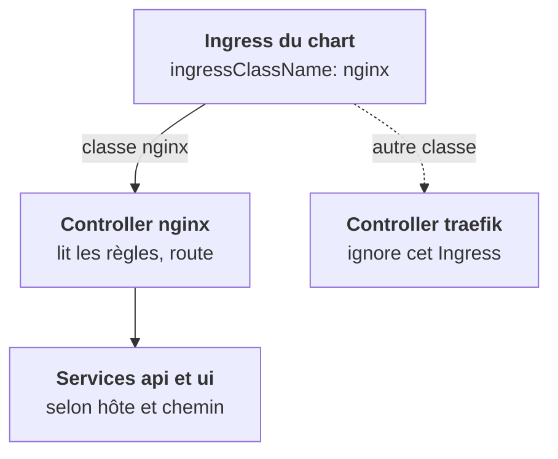

<Idee>
Un **Ingress** est une liste de règles : « ce nom d'hôte et ce chemin vont vers ce Service ». Il ne fait rien tout seul. Il faut un **ingress controller**, un proxy qui lit ces règles et route vraiment le trafic.
</Idee>

<Analogie>
Un numéro public unique avec un **menu vocal** : « tapez 1 pour le chat, 2 pour l'API ». L'Ingress est le **script** du menu, sur papier. Le controller est l'**automate** qui le lit et aiguille les appels. Sans automate, le script reste dans un tiroir.
</Analogie>



## Pourquoi un Ingress

Un Service LoadBalancer par composant coûterait une IP et un équilibreur cloud chacun. L'Ingress mutualise : **un** point d'entrée HTTP(S) pour tous. Le controller (nginx, Traefik, HAProxy, Envoy, ou celui du cloud comme GKE Ingress) est lui-même exposé par un Service LoadBalancer ou NodePort.

## Un Ingress, en lecture rapide

```yaml
metadata:
  annotations:
    nginx.ingress.kubernetes.io/proxy-body-size: 50m   # propre à nginx
spec:
  ingressClassName: nginx          # QUEL controller le traite
  tls:
    - hosts: [chat.client.example]
      secretName: chat-tls         # Secret kubernetes.io/tls
  rules:
    - host: chat.client.example
      http:
        paths:
          - path: /api
            pathType: Prefix
            backend:
              service: { name: api, port: { number: 8080 } }
```

Avec une seconde règle qui envoie `/` vers le Service `ui`, voici ce que ça donne :

| Requête | Où elle va |
|---|---|
| `chat.client.example/api/v1/chat` | ✔ Service `api` |
| `chat.client.example/` | ✔ Service `ui` |
| `autre.example/` | ✘ 404, aucune règle |

## Les quatre points à surveiller

- **`ingressClassName`** : un cluster client peut avoir plusieurs controllers, ou un seul au nom inattendu (`nginx-internal`, `traefik`, `gce`, `openshift-default`). Sans classe ou avec une classe inexistante, personne ne traite l'Ingress.
- **Les annotations** sont propres à chaque controller : timeouts, taille des uploads, réécriture de chemin, IP source autorisées. Chaque marque d'automate a ses réglages.
- **TLS** : le certificat est un Secret, que cert-manager (étape 9) peut générer et renouveler. Le controller termine TLS ; derrière, HTTP en clair.
- **OpenShift** utilise par défaut des **Routes**. Les Ingress y sont convertis dans la plupart des cas, mais pas leurs annotations.

<Terrain>
`ingressClassName` est **la** valeur de chart à surcharger chez chaque client. Sur un cluster neuf, vérifie aussi qu'un controller est installé : sans lui, l'Ingress est un objet inerte.
</Terrain>

<Piege>
Un Ingress ignoré ne produit aucune erreur. Le réflexe : `kubectl get ingressclass`, puis comparer avec le `ingressClassName` rendu par ton chart.
</Piege>

<Retenir>
L'Ingress déclare des règles, le controller les applique. Sans controller ou avec une mauvaise classe, rien ne se passe, en silence. Classe et annotations dépendent du client : à surcharger.
</Retenir>
