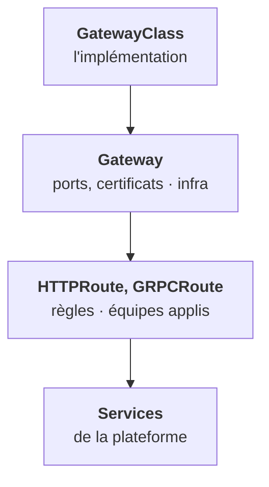
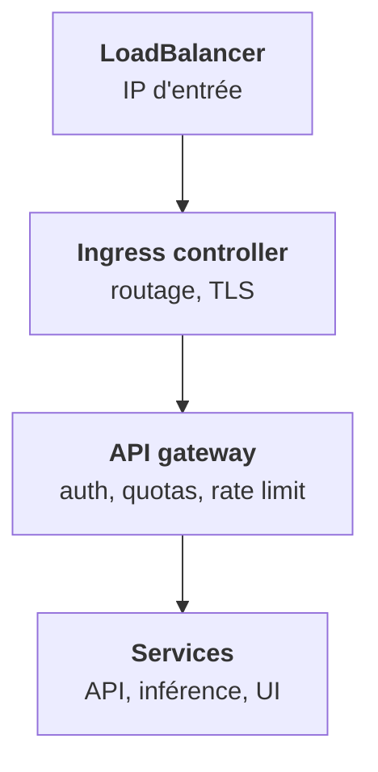

L'Ingress est figé : tout ce qui dépasse le routage simple passe par des annotations propres à chaque controller. **Gateway API** le remplace progressivement. Et il ne faut pas le confondre avec l'**API gateway** de la plateforme, qui est autre chose.

## Trois objets, trois rôles

Gateway API standardise ce qui était des annotations : réécriture, en-têtes, **pondération pour du canari**, gRPC. Sur GKE et avec Cilium ou Envoy Gateway, c'est déjà le défaut. Ton chart devra probablement rendre l'un ou l'autre, Ingress ou routes, selon le client.

## Ingress controller et API gateway

Les deux s'appellent « gateway » dans les conversations, mais ne font pas le même métier.

| | Ingress controller | API gateway |
|---|---|---|
| Rôle | Routage L7 générique | Logique d'API de la plateforme |
| Ce qu'il fait | Hôte, chemin, TLS | Authentification, quotas, rate limiting, transformation |
| Exemples | nginx, Traefik, GKE | Kong, Envoy, Tyk, composant maison |

Dans la plateforme, la chaîne typique est :

Les deux existent souvent en même temps. Quand un client demande « où sont appliqués les quotas », la réponse n'est pas l'Ingress. L'étape 12 reprendra cette chaîne au niveau de la plateforme, avec le durcissement de la gateway.

<Retenir>
Gateway API sépare l'implémentation, l'entrée gérée par l'infra et les routes des applis, et standardise ce qui était des annotations. L'API gateway est un autre maillon, derrière l'ingress : auth, quotas, rate limiting.
</Retenir>
