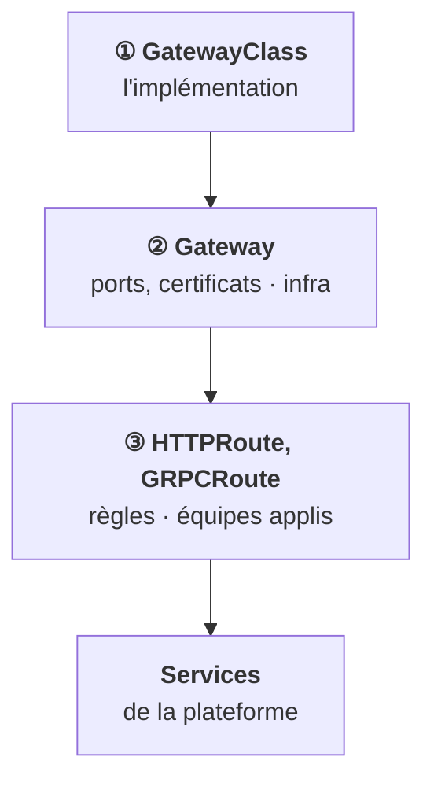
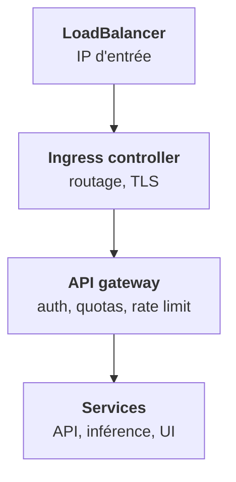

<Idee>
Deux choses portent le mot « gateway », et ce ne sont pas les mêmes. **Gateway API** est le successeur de l'Ingress : les mêmes règles de routage, découpées en trois objets. L'**API gateway** est un composant de la plateforme, placé derrière, qui vérifie qui appelle et combien.
</Idee>

<Analogie>
Gateway API découpe le script du menu vocal en trois feuilles, avec trois auteurs : la marque de l'automate, la ligne et ses numéros (le service télécom), le menu de chaque département. L'API gateway, c'est **après** le menu : l'agent qui te demande ton numéro client et vérifie ton forfait.
</Analogie>

## Gateway API : trois objets, trois rôles

L'Ingress est figé : tout ce qui dépasse le routage simple passe par des annotations propres à chaque controller. Gateway API le remplace progressivement.

Gateway API standardise ce qui était des annotations : réécriture, en-têtes, **pondération pour du canari**, gRPC. Sur GKE et avec Cilium ou Envoy Gateway, c'est déjà le défaut.

<Terrain>
Ton chart devra probablement rendre l'un ou l'autre, Ingress ou routes, selon le client.
</Terrain>

## Ingress controller et API gateway

Les deux s'appellent « gateway » dans les conversations, mais ne font pas le même métier.

<Compare>
<Cas titre="Ingress controller">

Routage L7 générique.

- hôte, chemin
- TLS
- nginx, Traefik, GKE

</Cas>
<Cas titre="API gateway">

Logique d'API de la plateforme.

- authentification
- quotas, rate limiting
- transformation
- Kong, Envoy, Tyk, composant maison

</Cas>
</Compare>

Les deux existent souvent en même temps, l'un derrière l'autre :

<Piege>
Un client demande « où sont appliqués les quotas ? ». La réponse n'est pas l'Ingress : c'est l'API gateway. L'étape 12 reprendra cette chaîne au niveau de la plateforme, avec le durcissement de la gateway.
</Piege>

<Retenir>
Gateway API sépare l'implémentation, l'entrée gérée par l'infra et les routes des applis, et standardise ce qui était des annotations. L'API gateway est un autre maillon, derrière l'ingress : auth, quotas, rate limiting.
</Retenir>
