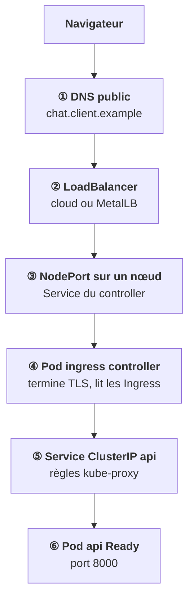
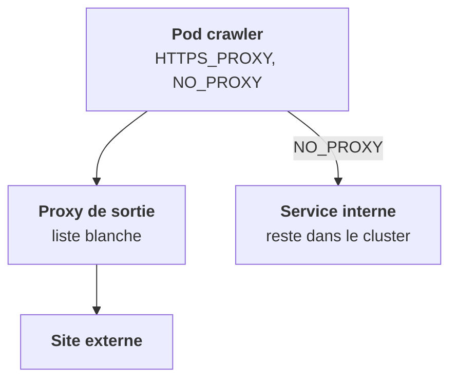

<Idee>
Une requête qui vient de l'extérieur traverse **six maillons** avant d'atteindre ton pod. Chacun est un endroit où ça peut casser, et chacun se vérifie séparément. Dans l'autre sens, un pod qui sort passe souvent par un proxy imposé par le client.
</Idee>

<Analogie>
Suivre un appel de bout en bout : l'annuaire public, le numéro de l'opérateur, la porte de l'immeuble, l'automate du menu, le numéro du service, puis l'agent. En sortie, tous les appels affichent le **numéro de l'entreprise**, et certains clients imposent de passer par un standardiste qui n'a le droit d'appeler qu'une liste de numéros.
</Analogie>

## De l'extérieur vers un pod

Deux points à retenir de ce trajet :

- Le LoadBalancer et le NodePort ne font qu'**acheminer**. La première décision par hôte et par chemin est prise au maillon ④, dans le pod du controller.
- **TLS s'arrête là.** Derrière, entre le controller et tes pods, c'est du HTTP en clair (étape 0).

## D'un pod vers l'extérieur

En sortie, le pod utilise l'**IP du nœud** (SNAT), sauf configuration particulière. Un client exigeant impose un **proxy de sortie** obligatoire, avec une liste blanche de destinations : par variables `HTTP_PROXY`, `HTTPS_PROXY` et `NO_PROXY` dans les pods, ou par interception transparente.

<Compare>
<Cas ton="ok" titre="NO_PROXY complet">

Les plages internes du cluster y sont. L'appel entre services reste dans le cluster.

</Cas>
<Cas ton="ko" titre="NO_PROXY incomplet">

L'appel entre services part vers le proxy, et échoue.

</Cas>
</Compare>

<Terrain>
Les composants qui sortent **à la demande de l'utilisateur** (crawler, connecteurs, exécution de code) doivent être bloqués vers les plages privées. C'est la protection contre le **SSRF**, détaillée à l'étape 12.
</Terrain>

<Retenir>
DNS public, LoadBalancer, NodePort, controller, Service, pod : six maillons, chacun vérifiable. En sortie, l'IP du nœud ; avec un proxy imposé, `NO_PROXY` doit couvrir l'interne, et les composants pilotés par l'utilisateur ne doivent pas joindre les plages privées.
</Retenir>
