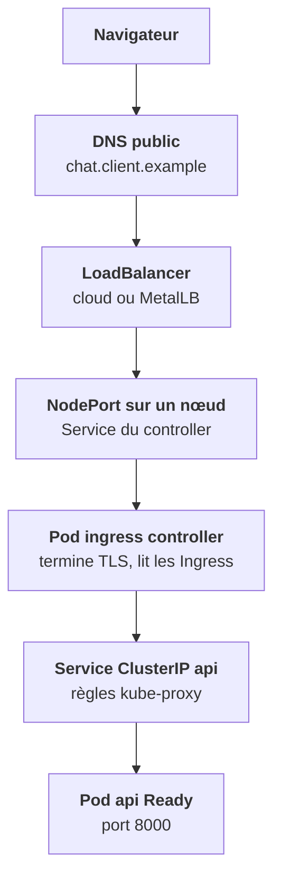
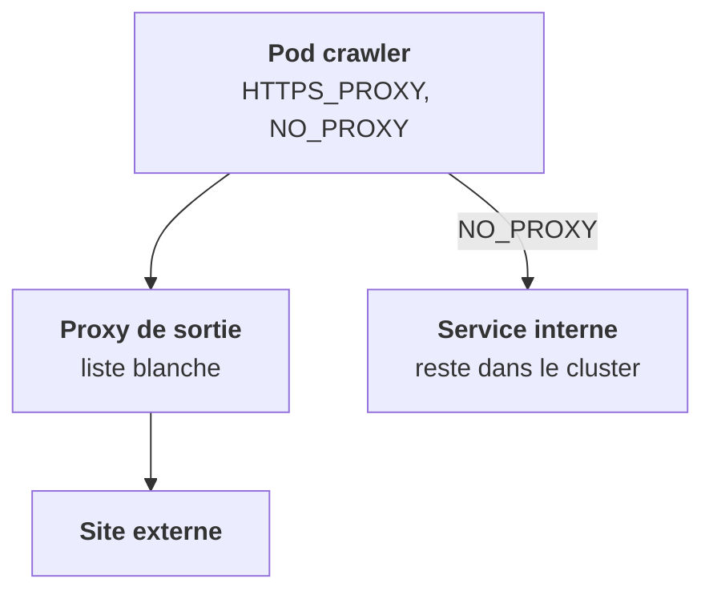

Chaque maillon de la chaîne est un endroit où ça peut casser, et chacun a sa commande de vérification. Avant d'ouvrir la boîte à outils, mets la chaîne entière dans l'ordre.

## De l'extérieur vers un pod

Deux points à retenir de ce trajet. Le LoadBalancer et le NodePort ne font qu'acheminer : la première décision par hôte et par chemin est prise dans le pod du controller. Et TLS s'arrête là : derrière, entre le controller et tes pods, c'est du HTTP en clair (étape 0).

## D'un pod vers l'extérieur

En sortie, le pod utilise l'**IP du nœud** (SNAT), sauf configuration particulière. Un client exigeant impose un **proxy de sortie** obligatoire, avec une liste blanche de destinations : par variables `HTTP_PROXY`, `HTTPS_PROXY` et `NO_PROXY` dans les pods, ou par interception transparente.

Deux conséquences immédiates :

1. **`NO_PROXY` doit contenir les plages internes du cluster.** Sinon les appels entre services partent vers le proxy et échouent.
2. **Les composants qui sortent à la demande de l'utilisateur** (crawler, connecteurs, exécution de code) doivent être bloqués vers les plages privées. C'est la protection contre le **SSRF**, détaillée à l'étape 12.

<Retenir>
DNS public, LoadBalancer, NodePort, controller, Service, pod : six maillons, chacun vérifiable. En sortie, l'IP du nœud ; avec un proxy imposé, `NO_PROXY` doit couvrir l'interne, et les composants pilotés par l'utilisateur ne doivent pas joindre les plages privées.
</Retenir>
