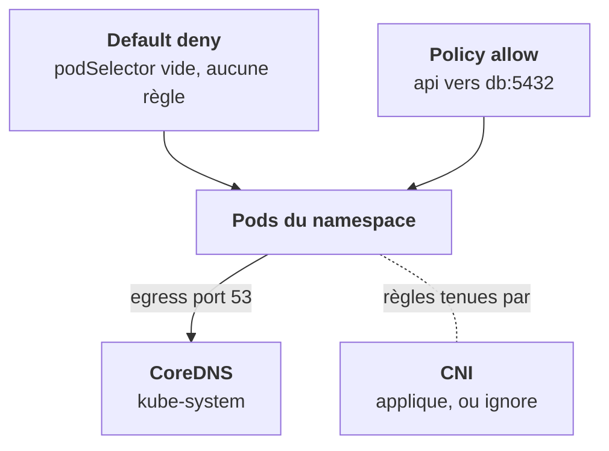

Par défaut, **tout pod peut parler à tout pod** : c'est la règle 2 du modèle. Une **NetworkPolicy** restreint ça, pour les pods qu'elle sélectionne. Encore faut-il que le CNI l'applique.

```yaml
kind: NetworkPolicy             # db-only-from-api, namespace platform
spec:
  podSelector:
    matchLabels: { app: db }             # les pods PROTÉGÉS
  policyTypes: [Ingress, Egress]
  ingress:
    - from:
        - podSelector:
            matchLabels: { app: api }    # seuls eux entrent
      ports: [{ port: 5432 }]
  egress:
    - to:
        - namespaceSelector: {}          # tous les namespaces…
          podSelector:
            matchLabels: { k8s-app: kube-dns }   # …ET CoreDNS
      ports: [{ port: 53, protocol: UDP }]
```

## Les règles de lecture

- Dès qu'**une** policy sélectionne un pod pour un type (Ingress ou Egress), **tout ce qui n'est pas autorisé est refusé** pour ce type. Un pod sélectionné par aucune policy reste totalement ouvert.
- Les policies sont **additives** : plusieurs policies sur un pod, on prend l'union. Il n'y a pas de règle « deny ».
- `namespaceSelector` et `podSelector` dans le **même** élément de liste = **ET** ; dans deux éléments = **OU**.



## Default deny, sans oublier le DNS

Le pattern d'un namespace fermé : une policy avec `podSelector` vide et `policyTypes` Ingress et Egress, sans aucune règle. Ensuite on ouvre au cas par cas. **N'oublie jamais le DNS en egress.**

## Présente et sans effet

Une NetworkPolicy sans CNI qui l'applique est **acceptée par l'API et ignorée** : aucune erreur, aucune alerte. Sur kind avec kindnet, c'est exactement ce qui se passe. Les policies sont L3/L4 (IP, port) ; pour filtrer par chemin ou méthode HTTP, il faut Cilium ou un mesh.

<Retenir>
Une policy ferme tout ce qu'elle n'autorise pas, pour les pods qu'elle sélectionne ; les policies s'additionnent. Default deny, puis DNS, puis le reste. Et rien de tout ça n'existe si le CNI du client ne les applique pas.
</Retenir>
