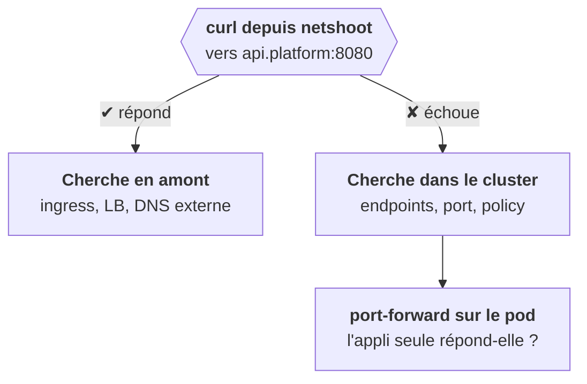
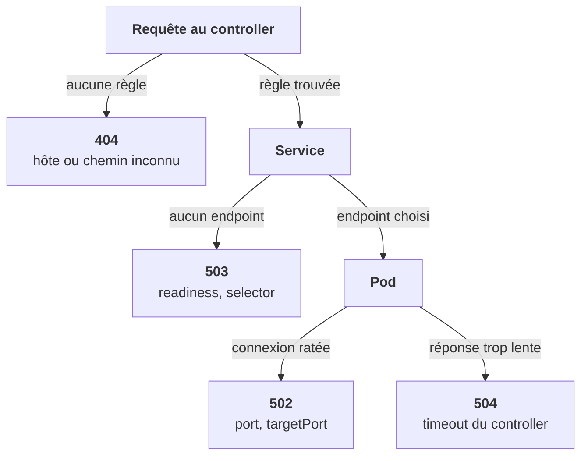

<Idee>
« C'est injoignable » ne dit pas **où**. La méthode : tester depuis l'intérieur du cluster pour couper la chaîne en deux, puis vérifier maillon par maillon. Et le code HTTP renvoyé par le controller dit déjà quel maillon a lâché.
</Idee>

<Analogie>
Quatre façons de rater un appel. **404** : « ce choix n'existe pas au menu ». **503** : « aucun agent n'est connecté ». **502** : on te transfère, mais le poste ne décroche pas. **504** : l'agent a décroché, mais te laisse en attente trop longtemps et l'automate raccroche.
</Analogie>

## Couper la chaîne en deux

## L'ordre des vérifications

On part du Service, on descend jusqu'au pod, puis on remonte vers l'entrée.

1. **Le Service a-t-il des cibles ?** `kubectl get endpoints`. `<none>` : selector ou readiness.
2. **Le selector correspond-il ?** `kubectl get pods -l app=api --show-labels`. Rien : faute dans le selector ou dans le chart.
3. **Le pod écoute-t-il sur le targetPort ?** `ss -ltnp` dans le pod. Cherche `0.0.0.0:8000`, pas `127.0.0.1`.
4. **Joignable de l'intérieur ?** Un `curl` depuis netshoot. Ça marche : le problème est en amont. Ça échoue : Service, pod ou NetworkPolicy.
5. **L'appli seule ?** `port-forward` sur le pod. Ça marche : l'application est saine, le problème est entre les deux.
6. **Côté Ingress.** `ADDRESS` vide : aucun controller ne l'a pris ; vérifie `kubectl get ingressclass`, puis le log du controller.
7. **Une NetworkPolicy ?** `kubectl get networkpolicy -A`, puis `describe`.

## Les codes du controller, une carte

| Code | Ce que ça veut dire | Où regarder |
|---|---|---|
| **404** | Aucune règle ne matche l'hôte ou le chemin | `host` mal écrit, classe absente |
| **502** | Endpoint joint, connexion échouée | Pod qui n'écoute pas, mauvais targetPort |
| **503** | Aucun endpoint | Readiness, selector |
| **504** | Le backend n'a pas répondu à temps | Timeout du controller |

<Terrain>
Le 504 concerne directement la plateforme : pour les requêtes d'inférence longues, c'est ce timeout du controller qu'on ajuste par annotation.
</Terrain>

<Retenir>
Endpoints, labels, port d'écoute, curl interne, port-forward, Ingress, policies : dans cet ordre. Au controller : 404 pas de règle, 502 connexion ratée, 503 pas d'endpoint, 504 trop lent.
</Retenir>
